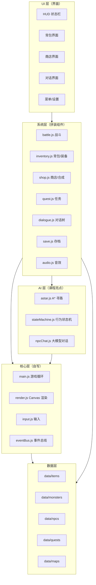
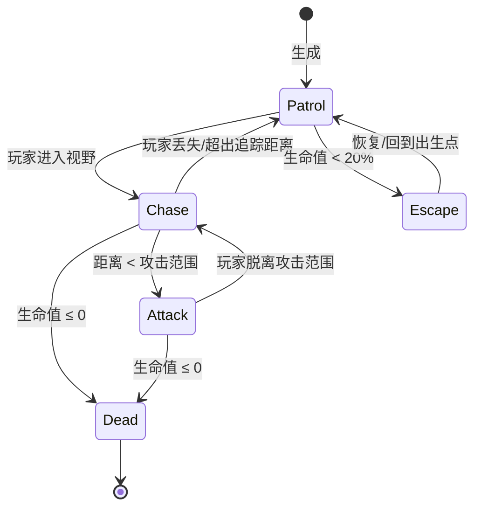
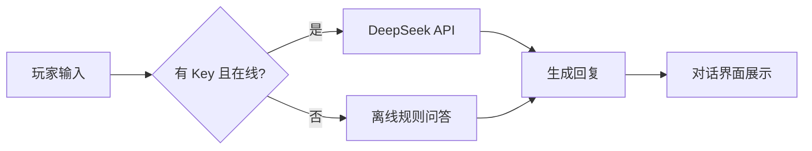
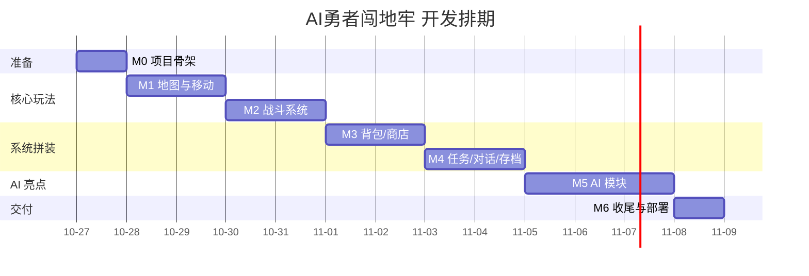

# 《AI勇者闯地牢：像素冒险RPG小游戏》开发规划书

| 项 | 值 |
|---|---|
| 课程 | 《人工智能基础》大作业 |
| 项目类型 | 小游戏（AI 应用型） |
| 作者 | 黄文博（软件245） |
| 版本 | v1.0 |
| 日期 | 2026-10-26 |
| 状态 | 已定题登记，待开发 |
| 仓库 | https://github.com/aLie/ai-dungeon-rpg（待创建） |

> 本文档为项目开发规划书，长期维护于仓库根目录（`PLAN.md`），随里程碑推进更新，作为需求基线、架构设计、拼装清单、开发排期与验收依据。

---

## 1. 项目概述

### 1.1 背景

《人工智能基础》课程要求完成一个大作业，可选工具软件、管理系统、游戏或 AI 短剧。本选题为 **《AI勇者闯地牢：像素冒险RPG小游戏》**，采用**组件化拼装**思路，集成多个 GitHub 开源组件搭建一款功能完整的 AI 冒险 RPG，并嵌入三类 AI 技术：**A\* 寻路、AI 行为状态机、大模型 NPC 对话**。

### 1.2 项目目标

| 目标类型 | 内容 |
|---|---|
| 功能目标 | 交付可离线运行、可在线演示、功能完整（探索/战斗/背包/商店/任务/对话/存档）的 RPG 小游戏 |
| 学习目标 | 掌握组件化代码复用、Canvas 2D 游戏开发、AI 搜索算法、提示工程与 API 集成 |
| 交付目标 | 代码托管 GitHub、GitHub Pages 在线试玩、README 与来源声明完整、答辩可演示可讲解 |

### 1.3 项目亮点

| 亮点 | 说明 |
|---|---|
| 组件化拼装 | 20+ 可拼组件点，全部来自开源项目，README 逐一声明来源与协议 |
| AI 三层设计 | A\* 寻路（搜索算法）+ AI 状态机（决策）+ 大模型对话（生成式 AI） |
| 零构建可玩 | 双击 `index.html` 即可运行，无依赖安装、无构建步骤 |
| 在线演示 | GitHub Pages 一键部署，评委可在线试玩 |

---

## 2. 需求分析

### 2.1 痛点分析

1. 市面上小游戏多玩法单一、系统单薄，缺乏完整 RPG 体验。
2. 多数小游戏 AI 含量低，难以体现人工智能课程所学的 AI 工具应用与算法能力。
3. 同类课程项目同质化严重（见班级选题登记表：17/34 为小游戏），需要差异化。
4. 个人开发时间有限，需要以组件化拼装控制开发成本。

### 2.2 功能需求（FR）

| 编号 | 功能 | 说明 | 优先级 |
|---|---|---|---|
| FR-01 | 地图探索 | 随机生成迷宫地图，支持多楼层场景切换 | P0 |
| FR-02 | 角色移动 | 键盘/触屏移动，碰撞检测，与障碍物/事件点交互 | P0 |
| FR-03 | 回合制战斗 | 玩家 vs 怪物，指令：攻击/技能/防御/逃跑 | P0 |
| FR-04 | 属性成长 | 生命/攻击/防御/金币/经验，升级加点 | P0 |
| FR-05 | 道具掉落 | 战斗胜利随机掉落物品 | P1 |
| FR-06 | 背包管理 | 物品拾取、使用、丢弃、堆叠 | P0 |
| FR-07 | 装备系统 | 武器/防具穿戴，属性加成，装备位校验 | P1 |
| FR-08 | 道具合成 | 配方合成更高级物品 | P2 |
| FR-09 | 商店交易 | 金币买卖，随机商品刷新 | P1 |
| FR-10 | 任务系统 | 主线/支线任务链，完成判定与奖励 | P1 |
| FR-11 | NPC 对话 | 分支对话树；AI 自由对话（可选开启） | P1 |
| FR-12 | 本地存档 | localStorage 存档/读档/多槽位 | P0 |
| FR-13 | 音效 | 战斗/拾取/交互基础音效 | P2 |
| FR-14 | UI/HUD | 生命/金币/经验显示，菜单系统 | P0 |
| FR-15 | 敌人 AI | A\* 寻路追踪玩家 + 巡逻/追击/逃离状态机 | P0（AI 亮点） |
| FR-16 | AI 对话 | 接入大模型 API 的自由对话 NPC，含离线兜底 | P1（AI 亮点） |

### 2.3 非功能需求（NFR）

| 编号 | 需求 | 指标/约束 |
|---|---|---|
| NFR-01 | 离线可用 | 不联网（无 API Key）时核心玩法完整可玩 |
| NFR-02 | 零构建 | 浏览器直接打开 `index.html` 可运行，无编译/打包 |
| NFR-03 | 浏览器兼容 | Chrome / Edge 最新两个大版本 |
| NFR-04 | 性能 | 普通笔记本单帧渲染 ≤ 16ms（60 FPS） |
| NFR-05 | 数据持久化 | 存档基于 localStorage，刷新不丢 |
| NFR-06 | 安全 | API Key 不写入代码仓库；不泄露至 GitHub |
| NFR-07 | 开源合规 | 所有借鉴代码按协议声明来源，LICENSE 采用 MIT |

---

## 3. 技术选型

| 选型项 | 方案 | 理由 |
|---|---|---|
| 语言 | 原生 JavaScript（ES6+） | 零依赖、无构建，浏览器原生支持 |
| 渲染 | Canvas 2D | 像素风渲染简单、性能可控 |
| 模块化 | 普通 `<script>` 顺序加载 + 全局命名空间（`window.Game`） | 规避 `file://` 下 ES Module 与 fetch 的 CORS 限制，保证双击即玩 |
| 数据 | `data.js` 常量文件（`const ITEMS = {...}`） | `file://` 下无法 fetch JSON，改用 JS 文件定义数据 |
| AI 对话 | DeepSeek API（OpenAI 兼容协议） | 中文能力强、按量计费、成本低 |
| AI 对话兜底 | 本地规则（预置问答 + 关键词匹配） | 无 Key/断网时功能可用 |
| 寻路 | 自写 A\*（参考 PathFinding.js 实现） | 算法约 100 行，答辩可讲解 |
| 存档 | localStorage | 简单可靠，无后端 |
| 部署 | GitHub Pages | 免费、零配置、在线演示 |

**关键设计决策**

1. **禁用 ES Module / fetch 加载数据**：浏览器以 `file://` 打开本地 HTML 时，模块加载和 fetch 均受 CORS 限制。为保证"双击即玩"，全部脚本用普通 `<script>` 标签按依赖顺序加载，数据以 JS 常量文件提供。
2. **事件总线解耦**：模块间不直接引用，统一通过 `eventBus` 发布/订阅（如 `inventory:itemAdded`），避免循环依赖，保证组件可插拔。
3. **数据驱动**：物品、怪物、NPC、任务、地图全部配置化，逻辑与数据分离，便于拼装与调试。

---

## 4. 系统架构

### 4.1 分层架构



### 4.2 模块职责表

| 模块 | 文件 | 职责 | 来源 |
|---|---|---|---|
| 游戏循环 | `js/core/main.js` | requestAnimationFrame 主循环、场景切换、状态调度 | 自写 |
| 渲染 | `js/core/render.js` | Canvas 绘制地图/角色/UI | 自写 |
| 输入 | `js/core/input.js` | 键盘/触屏事件分发 | 自写 |
| 事件总线 | `js/core/eventBus.js` | 模块间发布/订阅通信 | 自写 |
| 地图 | `js/systems/map.js` | 网格地图、随机生成（DFS 回溯）、楼层切换 | 自写 |
| 战斗 | `js/systems/battle.js` | 回合制战斗、伤害公式、经验掉落 | 参考 freeCodeCamp RPG 教程重构 |
| 背包 | `js/systems/inventory.js` | 物品堆叠、使用、装备位校验、属性加成 | 参考 @reldens/items-system 逻辑重构 |
| 商店 | `js/systems/shop.js` | 买卖、随机刷新、合成 | 自写 |
| 任务 | `js/systems/quest.js` | 任务链、进度判定、奖励 | 自写 |
| 对话 | `js/systems/dialogue.js` | 分支对话树渲染 | 自写 |
| 存档 | `js/systems/save.js` | localStorage 序列化/读档 | 自写 |
| 音效 | `js/systems/audio.js` | WebAudio 简单音效 | 自写 |
| 寻路 | `js/ai/astar.js` | A\* 寻路 + 访问统计 | 参考 PathFinding.js（MIT）重构 |
| 状态机 | `js/ai/stateMachine.js` | 敌人巡逻/追击/逃离/攻击状态 | 自写 |
| AI 对话 | `js/ai/npcChat.js` | DeepSeek API 调用 + 离线兜底 | 自写 |

### 4.3 目录结构

```
ai-dungeon-rpg/
├── index.html              # 入口页（双击即玩）
├── css/
│   └── style.css
├── js/
│   ├── core/               # 核心层
│   │   ├── main.js
│   │   ├── render.js
│   │   ├── input.js
│   │   └── eventBus.js
│   ├── systems/            # 系统层（拼装组件）
│   │   ├── map.js
│   │   ├── battle.js
│   │   ├── inventory.js
│   │   ├── shop.js
│   │   ├── quest.js
│   │   ├── dialogue.js
│   │   ├── save.js
│   │   └── audio.js
│   ├── ai/                 # AI 层
│   │   ├── astar.js
│   │   ├── stateMachine.js
│   │   └── npcChat.js
│   └── data/               # 数据层
│       ├── items.js
│       ├── monsters.js
│       ├── npcs.js
│       ├── quests.js
│       └── maps.js
├── assets/                 # 图片/音效素材
│   ├── img/
│   └── audio/
├── README.md
├── PLAN.md
├── LICENSE                 # MIT
└── .gitignore
```

---

## 5. 组件拼装清单

### 5.1 拼装原则

1. **能自写的不引依赖**：核心逻辑（地图、战斗、存档、任务）自写，保证答辩可讲解。
2. **能借鉴的读源码重写**：背包、装备等成熟系统读开源源码摘核心逻辑，重写为自有模块，文件头注明来源与协议。
3. **成熟算法直接引入**：A\* 等通用算法引入单文件实现并二次开发（增加统计输出）。
4. **零构建红线**：任何组件不引入需要打包的 npm 依赖；浏览器可直接运行。
5. **来源必声明**：README 与文件头逐一声明借鉴来源及 LICENSE。

### 5.2 拼装来源

| 系统 | 来源 | 协议 | 拼装方式 | 风险 |
|---|---|---|---|---|
| 游戏骨架/战斗/商店 | freeCodeCamp《Building a Role Playing Game》（Dragon Repeller） | 开源教程 | 参考结构重构 | 低 |
| 背包/装备/物品 | `@reldens/items-system`（npm） | MIT | 读源码摘核心逻辑自写 | 中（逻辑较重） |
| 背包 UI 交互 | Template Foundry《HTML5 RPG Inventory System》 | 免费框架 | 借鉴交互与布局 | 低 |
| A\* 寻路 | PathFinding.js（qiao） | MIT | 引入单文件版并二次开发 | 低 |
| 地图生成 | 自写（DFS 回溯） | — | 自写 | 低 |
| 存档 | localStorage 自写 | — | 自写 | 低 |
| AI 对话 | DeepSeek API | 服务条款 | API 集成 + 离线兜底 | 中（依赖 Key） |
| 音效/UI | 自写 + 免费 CC0 素材 | CC0 | 素材引入需记录来源 | 低 |

### 5.3 风险等级说明

- **低**：纯本地逻辑，无外部依赖，进度风险小。
- **中**：涉及外部依赖（npm 包逻辑重写、API Key），需预留返工时间或兜底方案。

---

## 6. AI 模块设计

### 6.1 A\* 寻路（FR-15）

- **用途**：怪物追踪玩家，跨楼层房间寻路。
- **原理**：结合 Dijkstra 与贪心最佳优先，估价函数 `f(n) = g(n) + h(n)`，`h` 采用曼哈顿距离。
- **复杂度**：`O(b^d)`，`b` 为分支因子，`d` 为路径深度；网格场景 `d` 受地图尺寸限制。
- **二次开发点**：输出访问节点数、路径长度、每步 `g/h/f` 值，用于答辩展示与算法对比。
- **实现参考**：PathFinding.js（MIT），单文件约 300 行，摘核心 `BinaryHeap` 与 `AStarFinder` 重构。

### 6.2 AI 行为状态机（FR-15）



状态迁移条件全部配置化（视野半径、攻击范围、逃跑阈值），便于调参。

### 6.3 大模型 NPC 对话（FR-16）

- **接口**：OpenAI 兼容协议；`base_url: https://api.deepseek.com`；模型 `deepseek-chat`。
- **Prompt 设计**：系统提示词注入角色设定（姓名、背景、说话风格、可透露信息白名单），限制输出长度。
- **Key 安全**：Key 由玩家在设置页手动输入，存 `localStorage`，**不写入代码、不提交仓库**；README 说明获取方式。
- **三级容错**：
  1. 本地 Key + 直接调用；
  2. 云端代理（可选部署）；
  3. 离线兜底（预置问答 + 关键词匹配），无 Key/断网/限流时自动降级。



---

## 7. 数据设计

核心实体：`Player`、`Item`、`Monster`、`NPC`、`Quest`、`Map`。数据以 `data/*.js` 常量提供。

```js
// data/items.js —— 示例
const ITEMS = {
  sword_iron: {
    id: "sword_iron",
    name: "铁剑",
    type: "weapon",          // weapon | armor | consumable | material
    atk: 5,
    price: 60,
    stackable: false,
    icon: "assets/img/sword_iron.png"
  },
  potion_small: {
    id: "potion_small",
    name: "小血瓶",
    type: "consumable",
    heal: 30,
    price: 15,
    stackable: true,
    maxStack: 9
  }
};

// data/monsters.js —— 示例
const MONSTERS = {
  slime: {
    id: "slime",
    name: "史莱姆",
    hp: 40, atk: 6, def: 2,
    exp: 10, gold: [3, 8],
    drops: [{ itemId: "potion_small", rate: 0.3 }],
    ai: { vision: 5, chaseRange: 12, escapeHp: 0.2, moveSpeed: 1 }
  }
};
```

装备位校验示例：`weapon` 仅可穿戴于武器槽，属性加成在装备/卸下时经事件总线广播重算。

---

## 8. 里程碑计划

### 8.1 阶段表

| 里程碑 | 交付物 | 验收标准 | 预估工时 |
|---|---|---|---|
| M0 | 项目骨架 | 浏览器打开 index.html 显示空场景与 60FPS 帧率 | 2h |
| M1 | 地图与移动 | 随机迷宫生成、键盘移动、碰撞、楼层切换 | 6h |
| M2 | 战斗系统 | 回合制战斗闭环，属性/经验/掉落生效 | 8h |
| M3 | 背包/商店 | 拾取、使用、穿戴、买卖、合成可用 | 8h |
| M4 | 任务/对话/存档 | 任务链完成判定、对话树、存档读写 | 6h |
| M5 | AI 模块 | 怪物 A\* 追踪、状态机行为、AI 对话（含兜底） | 10h |
| M6 | 收尾交付 | README 完整、Pages 在线可玩、演示录屏、答辩讲稿 | 4h |

合计约 **44h**，建议按每日 3-4h 分 2 周完成。

### 8.2 甘特图



---

## 9. GitHub 工程实践

### 9.1 仓库规划

- 名称：`ai-dungeon-rpg`；可见性：Public；LICENSE：MIT。
- 提交规范：`feat:` / `fix:` / `docs:` / `refactor:` 前缀，如 `feat: 战斗系统`。
- 分支：单人开发主用 `main`；大功能可开 `dev` 分支合并。

### 9.2 GitHub Pages 部署

1. 推送代码后进入仓库 Settings → Pages。
2. Source 选择 `Deploy from a branch` → 分支 `main`、目录 `/ (root)`。
3. 保存后等待 1-2 分钟，得到 `https://<username>.github.io/ai-dungeon-rpg/`。
4. 将在线链接写入 README 顶部。

### 9.3 README 必备内容

项目简介 → 在线试玩链接 → 演示 GIF → 功能列表 → 技术栈 → AI 亮点 → 运行方式（双击 index.html / `python -m http.server`）→ 组件来源声明表 → LICENSE。

### 9.4 开源合规

- 所有借鉴代码在文件头注释来源与协议，并在 README 汇总声明。
- 若借鉴代码协议要求保留版权声明，原样保留。
- 大模型 API 为服务调用，不涉及代码许可证传染。

---

## 10. 测试与验收

### 10.1 功能验收清单（对应 FR）

| 编号 | 验收步骤 | 通过标准 |
|---|---|---|
| FR-01 | 新开一局，连续切换 3 层 | 地图随机生成且每层不同 |
| FR-03 | 与怪物战斗 | 回合结算、伤害计算正确 |
| FR-06 | 拾取 10 个物品并堆叠 | 背包数量正确、无越界 |
| FR-07 | 穿戴铁剑 | 攻击属性实时 +5，卸下还原 |
| FR-09 | 商店买卖 | 金币增减正确、刷新后商品变化 |
| FR-10 | 完成主线任务 | 任务状态流转、奖励发放 |
| FR-12 | 存档后刷新页面 | 进度完整恢复 |
| FR-15 | 站在怪物视野内 | 怪物寻路追至攻击，丢失视野后回巡逻 |
| FR-16 | 断网/无 Key 与 NPC 对话 | 离线兜底正常应答 |

### 10.2 兼容性

- Chrome / Edge 最新两版：运行、存档、音效通过。
- 触屏设备：虚拟按键可完成核心操作。

### 10.3 答辩准备清单

- 演示脚本：2 分钟主线流程（探索→战斗→背包→商店→AI 对话）。
- 讲解点：A\* 估价函数与 g/h/f 展示、状态机迁移表、三级容错设计、组件拼装与来源声明。
- 备好离线演示（无 Key 版本），避免现场网络问题。

---

## 11. 风险与对策

| 风险 | 影响 | 对策 |
|---|---|---|
| 背包逻辑重写工作量大 | M3 延期 | 简化装备位为武器/防具 2 槽；合成降级为可选 |
| AI 对话依赖 Key/网络 | 演示翻车 | 三级容错，默认演示走离线兜底 |
| 组件拼装风格不一致 | 代码混乱 | 事件总线解耦 + 统一命名规范 + 每模块单一职责 |
| 时间不足（试读/其他课程） | 交付延期 | 严格按里程碑推进，P2 功能可裁剪不影响主线闭环 |
| file:// 下功能异常 | 双击不可玩 | 全程不用 ES Module/fetch，验收前必测双击打开 |

---

*本文件随开发推进持续更新；所有外部来源详见 README「组件来源声明」。*
