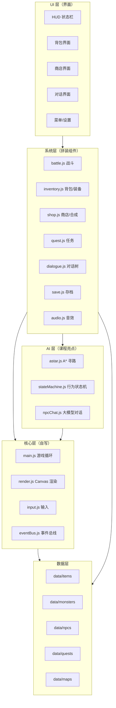
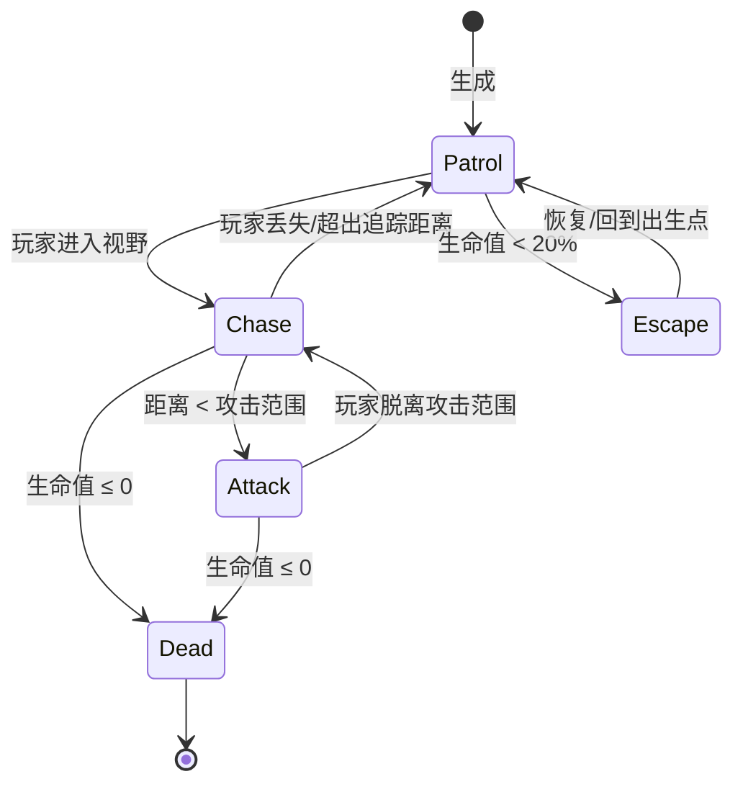
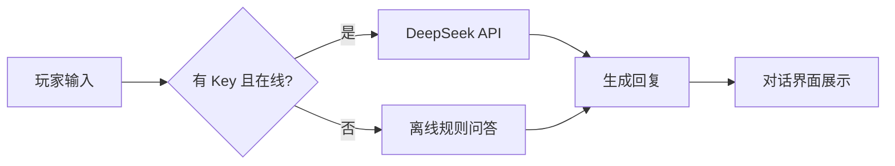

# 《AI勇者闯地牢：像素冒险RPG小游戏》开发规划书

| 项 | 值 |
|---|---|
| 课程 | 《人工智能基础》大作业 |
| 项目类型 | 小游戏（AI 应用型） |
| 作者 | 黄文博（软件245） |
| 版本 | v1.0 |
| 日期 | 2026-10-26 |
| 状态 | 已定题登记，仓库已就绪，计划框架确认中 |
| 仓库 | https://github.com/CodeKiller-3/ai-dungeon-rpg（已创建，main 已推送） |

> 本文档为项目开发规划书，长期维护于仓库根目录（`PLAN.md`），随里程碑推进更新，作为需求基线、架构设计、拼装清单、开发排期与验收依据。

---

## 1. 项目概述

### 1.1 背景

《人工智能基础》课程要求完成一个大作业，可选工具软件、管理系统、游戏或 AI 短剧。本选题为 **《AI勇者闯地牢：像素冒险RPG小游戏》**，采用**组件化拼装**思路，集成多个 GitHub 开源组件搭建一款功能完整的 AI 冒险 RPG，并嵌入三类 AI 技术：**A\* 寻路、AI 行为状态机、大模型 NPC 对话**。

### 1.2 项目目标

| 目标类型 | 内容 |
|---|---|
| 功能目标 | 交付可离线运行、可在线演示、功能完整（探索/战斗/背包/商店/任务/对话/存档）的 RPG 小游戏 |
| 学习目标 | 掌握组件化代码复用、Canvas 2D 游戏开发、AI 搜索算法、提示工程与 API 集成 |
| 交付目标 | 代码托管 GitHub、GitHub Pages 在线试玩、README 与来源声明完整、答辩可演示可讲解 |

### 1.3 项目亮点

| 亮点 | 说明 |
|---|---|
| 组件化拼装 | 20+ 可拼组件点，全部来自开源项目，README 逐一声明来源与协议 |
| AI 三层设计 | A\* 寻路（搜索算法）+ AI 状态机（决策）+ 大模型对话（生成式 AI） |
| 零构建可玩 | 双击 `index.html` 即可运行，无依赖安装、无构建步骤 |
| 在线演示 | GitHub Pages 一键部署，评委可在线试玩 |

---

## 2. 需求分析

### 2.1 痛点分析

1. 市面上小游戏多玩法单一、系统单薄，缺乏完整 RPG 体验。
2. 多数小游戏 AI 含量低，难以体现人工智能课程所学的 AI 工具应用与算法能力。
3. 同类课程项目同质化严重（见班级选题登记表：17/34 为小游戏），需要差异化。
4. 个人开发时间有限，需要以组件化拼装控制开发成本。

### 2.2 功能需求（FR）

| 编号 | 功能 | 说明 | 优先级 |
|---|---|---|---|
| FR-01 | 地图探索 | 随机生成迷宫地图，支持多楼层场景切换 | P0 |
| FR-02 | 角色移动 | 键盘/触屏移动，碰撞检测，与障碍物/事件点交互 | P0 |
| FR-03 | 回合制战斗 | 玩家 vs 怪物，指令：攻击/技能/防御/逃跑 | P0 |
| FR-04 | 属性成长 | 生命/攻击/防御/金币/经验，升级加点 | P0 |
| FR-05 | 道具掉落 | 战斗胜利随机掉落物品 | P1 |
| FR-06 | 背包管理 | 物品拾取、使用、丢弃、堆叠 | P0 |
| FR-07 | 装备系统 | 武器/防具穿戴，属性加成，装备位校验 | P1 |
| FR-08 | 道具合成 | 配方合成更高级物品 | P2 |
| FR-09 | 商店交易 | 金币买卖，随机商品刷新 | P1 |
| FR-10 | 任务系统 | 主线/支线任务链，完成判定与奖励 | P1 |
| FR-11 | NPC 对话 | 分支对话树；AI 自由对话（可选开启） | P1 |
| FR-12 | 本地存档 | localStorage 存档/读档/多槽位 | P0 |
| FR-13 | 音效 | 战斗/拾取/交互基础音效 | P2 |
| FR-14 | UI/HUD | 生命/金币/经验显示，菜单系统 | P0 |
| FR-15 | 敌人 AI | A\* 寻路追踪玩家 + 巡逻/追击/逃离状态机 | P0（AI 亮点） |
| FR-16 | AI 对话 | 接入大模型 API 的自由对话 NPC，含离线兜底 | P1（AI 亮点） |

### 2.3 非功能需求（NFR）

| 编号 | 需求 | 指标/约束 |
|---|---|---|
| NFR-01 | 离线可用 | 不联网（无 API Key）时核心玩法完整可玩 |
| NFR-02 | 零构建 | 浏览器直接打开 `index.html` 可运行，无编译/打包 |
| NFR-03 | 浏览器兼容 | Chrome / Edge 最新两个大版本 |
| NFR-04 | 性能 | 普通笔记本单帧渲染 ≤ 16ms（60 FPS） |
| NFR-05 | 数据持久化 | 存档基于 localStorage，刷新不丢 |
| NFR-06 | 安全 | API Key 不写入代码仓库；不泄露至 GitHub |
| NFR-07 | 开源合规 | 所有借鉴代码按协议声明来源，LICENSE 采用 MIT |

---

## 3. 技术选型

| 选型项 | 方案 | 理由 |
|---|---|---|
| 语言 | 原生 JavaScript（ES6+） | 零依赖、无构建，浏览器原生支持 |
| 渲染 | Canvas 2D | 像素风渲染简单、性能可控 |
| 模块化 | 普通 `<script>` 顺序加载 + 全局命名空间（`window.Game`） | 规避 `file://` 下 ES Module 与 fetch 的 CORS 限制，保证双击即玩 |
| 数据 | `data.js` 常量文件（`const ITEMS = {...}`） | `file://` 下无法 fetch JSON，改用 JS 文件定义数据 |
| AI 对话 | DeepSeek API（OpenAI 兼容协议） | 中文能力强、按量计费、成本低 |
| AI 对话兜底 | 本地规则（预置问答 + 关键词匹配） | 无 Key/断网时功能可用 |
| 寻路 | 自写 A\*（参考 PathFinding.js 实现） | 算法约 100 行，答辩可讲解 |
| 存档 | localStorage | 简单可靠，无后端 |
| 部署 | GitHub Pages | 免费、零配置、在线演示 |

**关键设计决策**

1. **禁用 ES Module / fetch 加载数据**：浏览器以 `file://` 打开本地 HTML 时，模块加载和 fetch 均受 CORS 限制。为保证"双击即玩"，全部脚本用普通 `<script>` 标签按依赖顺序加载，数据以 JS 常量文件提供。
2. **事件总线解耦**：模块间不直接引用，统一通过 `eventBus` 发布/订阅（如 `inventory:itemAdded`），避免循环依赖，保证组件可插拔。
3. **数据驱动**：物品、怪物、NPC、任务、地图全部配置化，逻辑与数据分离，便于拼装与调试。

---

## 4. 系统架构

### 4.1 分层架构



### 4.2 模块职责表

| 模块 | 文件 | 职责 | 来源 |
|---|---|---|---|
| 游戏循环 | `js/core/main.js` | requestAnimationFrame 主循环、场景切换、状态调度 | 自写 |
| 渲染 | `js/core/render.js` | Canvas 绘制地图/角色/UI | 自写 |
| 输入 | `js/core/input.js` | 键盘/触屏事件分发 | 自写 |
| 事件总线 | `js/core/eventBus.js` | 模块间发布/订阅通信 | 自写 |
| 地图 | `js/systems/map.js` | 网格地图、随机生成（DFS 回溯）、楼层切换 | 自写 |
| 战斗 | `js/systems/battle.js` | 回合制战斗、伤害公式、经验掉落 | 参考 freeCodeCamp RPG 教程重构 |
| 背包 | `js/systems/inventory.js` | 物品堆叠、使用、装备位校验、属性加成 | 参考 @reldens/items-system 逻辑重构 |
| 商店 | `js/systems/shop.js` | 买卖、随机刷新、合成 | 自写 |
| 任务 | `js/systems/quest.js` | 任务链、进度判定、奖励 | 自写 |
| 对话 | `js/systems/dialogue.js` | 分支对话树渲染 | 自写 |
| 存档 | `js/systems/save.js` | localStorage 序列化/读档 | 自写 |
| 音效 | `js/systems/audio.js` | WebAudio 简单音效 | 自写 |
| 寻路 | `js/ai/astar.js` | A\* 寻路 + 访问统计 | 参考 PathFinding.js（MIT）重构 |
| 状态机 | `js/ai/stateMachine.js` | 敌人巡逻/追击/逃离/攻击状态 | 自写 |
| AI 对话 | `js/ai/npcChat.js` | DeepSeek API 调用 + 离线兜底 | 自写 |

### 4.3 目录结构

```
ai-dungeon-rpg/
├── index.html              # 入口页（双击即玩）
├── css/
│   └── style.css
├── js/
│   ├── core/               # 核心层
│   │   ├── main.js
│   │   ├── render.js
│   │   ├── input.js
│   │   └── eventBus.js
│   ├── systems/            # 系统层（拼装组件）
│   │   ├── map.js
│   │   ├── battle.js
│   │   ├── inventory.js
│   │   ├── shop.js
│   │   ├── quest.js
│   │   ├── dialogue.js
│   │   ├── save.js
│   │   └── audio.js
│   ├── ai/                 # AI 层
│   │   ├── astar.js
│   │   ├── stateMachine.js
│   │   └── npcChat.js
│   └── data/               # 数据层
│       ├── items.js
│       ├── monsters.js
│       ├── npcs.js
│       ├── quests.js
│       └── maps.js
├── assets/                 # 图片/音效素材
│   ├── img/
│   └── audio/
├── README.md
├── PLAN.md
├── LICENSE                 # MIT
└── .gitignore
```

### 4.4 模块接口契约（全局命名空间）

所有模块挂 `window.Game` 命名空间，普通 `<script>` 顺序加载，模块间只经接口与事件总线交互。**Trae CN 生成任何模块时必须实现对应接口**：

```js
window.Game = {
  Core:    { Main, Render, Input, EventBus },
  Systems: { Map, Battle, Inventory, Shop, Quest, Dialogue, Save, Audio },
  Ai:      { AStar, StateMachine, NpcChat },
  Data:    { ITEMS, MONSTERS, NPCS, QUESTS, MAPS, Player }
};
```

| 模块 | 全局对象 | 关键接口（必须实现） |
|---|---|---|
| main.js | Game.Core.Main | init() / start() / switchScene(name) / loop(ts) |
| render.js | Game.Core.Render | drawMap(map, cam) / drawPlayer() / drawHUD() |
| input.js | Game.Core.Input | bind() / getState() / clear() |
| eventBus.js | Game.Core.EventBus | on(channel, fn) / off(channel, fn) / emit(channel, payload) |
| map.js | Game.Systems.Map | generate(seed) / isWalkable(x, y) / tileAt(x, y) / changeFloor(dir) |
| battle.js | Game.Systems.Battle | start(monsterId) / playerAction(cmd) / tick() |
| inventory.js | Game.Systems.Inventory | add(itemId, n) / remove(itemId, n) / use(itemId) / equip(itemId) / unequip(slot) / list() |
| shop.js | Game.Systems.Shop | refresh() / buy(itemId) / sell(itemId) / combine(idA, idB) |
| quest.js | Game.Systems.Quest | accept(id) / progress(eventName, payload) / isDone(id) / reward(id) |
| dialogue.js | Game.Systems.Dialogue | open(npcId, nodeId) / choose(optionId) / close() |
| save.js | Game.Systems.Save | write(slot) / read(slot) / slots() |
| audio.js | Game.Systems.Audio | preload() / play(name) |
| astar.js | Game.Ai.AStar | findPath(grid, start, goal) → { path, visited, steps:[{g,h,f}] } |
| stateMachine.js | Game.Ai.StateMachine | create(cfg) / setState(name) / update(dt) / getState() |
| npcChat.js | Game.Ai.NpcChat | ask(npcId, userMsg) → Promise\<string\> |

### 4.5 事件总线频道清单（模块间唯一通信方式）

| 频道 | Payload | 发布者 | 订阅者 |
|---|---|---|---|
| inventory:itemAdded | { itemId, count } | Inventory | HUD、Quest |
| inventory:itemRemoved | { itemId, count } | Inventory | HUD |
| inventory:equipChanged | { slot, itemId\|null } | Inventory | HUD、Battle（属性重算） |
| player:statsChanged | { stat, old, now } | Player / Inventory | HUD、StateMachine |
| battle:start | { monsterId } | Map（遇敌） | Battle UI |
| battle:end | { result, exp, gold, drops } | Battle | Quest、Inventory、HUD |
| quest:complete | { questId } | Quest | Dialogue、Save |
| map:floorChanged | { floor } | Map | Render、AStar、Save |
| dialogue:open / dialogue:close | { npcId } / {} | Dialogue | Input（锁定移动）、Save |
| save:write | { slot } | Save | HUD |
| npc:chatReply | { npcId, text } | NpcChat | Dialogue UI |
| game:sceneChanged | { scene } | Main | 全部 UI |

### 4.6 脚本加载顺序（零构建关键）

`index.html` 的 `<script>` 严格按以下顺序，**Trae CN 生成时不得乱序**：

1. `js/core/eventBus.js` → `js/core/input.js` → `js/core/render.js`
2. `js/data/items.js` → `monsters.js` → `npcs.js` → `quests.js` → `maps.js`
3. `js/systems/map.js` → `inventory.js` → `battle.js` → `shop.js` → `quest.js` → `dialogue.js` → `save.js` → `audio.js`
4. `js/ai/astar.js` → `stateMachine.js` → `npcChat.js`
5. `js/core/main.js`（**最后加载，启动入口**）

规则：core 先于 data，data 先于 systems/ai，main.js 最后；每个模块用 IIFE 挂 `window.Game`，不污染全局。

---

## 5. 组件拼装清单

### 5.1 拼装原则

1. **能自写的不引依赖**：核心逻辑（地图、战斗、存档、任务）自写，保证答辩可讲解。
2. **能借鉴的读源码重写**：背包、装备等成熟系统读开源源码摘核心逻辑，重写为自有模块，文件头注明来源与协议。
3. **成熟算法直接引入**：A\* 等通用算法引入单文件实现并二次开发（增加统计输出）。
4. **零构建红线**：任何组件不引入需要打包的 npm 依赖；浏览器可直接运行。
5. **来源必声明**：README 与文件头逐一声明借鉴来源及 LICENSE。

### 5.2 拼装来源（2026-10-27 前置可达性验证后修订）

| 系统 | 来源 | 协议 | 拼装方式 | 可达性验证 |
|---|---|---|---|---|
| 游戏骨架/战斗/商店 | freeCodeCamp《Learn Basic JavaScript by Building a Role Playing Game》（Dragon Repeller） | 开源教程 | 参考结构重构 | ✅ 已验证可达（200），教程 URL 已修正 |
| 背包/装备/物品 | freeCodeCamp RPG 教程重构 + 自写扩展 | 开源教程 | 读教程武器/装备逻辑，自写堆叠/装备位/属性加成 | ✅（原 `@reldens/items-system` 于 2026-10-27 验证 npm 403 / registry 超时 / GitHub 404，**来源弃用**） |
| 背包 UI 交互 | 自写（原参考 Template Foundry《HTML5 RPG Inventory System》） | — | 自写像素风 UI | ⚠️ Template Foundry 当前网络不可达（超时），降级为自写；若后续可达可参考交互布局 |
| A\* 寻路 | PathFinding.js（qiao） | MIT | 引入单文件版并二次开发（g/h/f 统计） | ✅ 已验证仓库存在（gh api） |
| 地图生成 | 自写（DFS 回溯） | — | 自写 | ✅ |
| 存档 | localStorage 自写 | — | 自写 | ✅ |
| AI 对话 | DeepSeek API | 服务条款 | API 集成 + 离线兜底 | ✅ 已验证 API 端点可达（401=未授权属预期，接入 Key 即可用） |
| 音效/UI | 自写 + 免费 CC0 素材 | CC0 | 素材引入需记录来源 | ✅ |

### 5.3 风险等级说明

- **低**：纯本地逻辑，无外部依赖，进度风险小。
- **中**：涉及外部依赖（npm 包逻辑重写、API Key），需预留返工时间或兜底方案。

---

## 6. AI 模块设计

### 6.1 A\* 寻路（FR-15）

- **用途**：怪物追踪玩家，跨楼层房间寻路。
- **原理**：结合 Dijkstra 与贪心最佳优先，估价函数 `f(n) = g(n) + h(n)`，`h` 采用曼哈顿距离。
- **复杂度**：`O(b^d)`，`b` 为分支因子，`d` 为路径深度；网格场景 `d` 受地图尺寸限制。
- **二次开发点**：输出访问节点数、路径长度、每步 `g/h/f` 值，用于答辩展示与算法对比。
- **实现参考**：PathFinding.js（MIT），单文件约 300 行，摘核心 `BinaryHeap` 与 `AStarFinder` 重构。

### 6.2 AI 行为状态机（FR-15）



状态迁移条件全部配置化（视野半径、攻击范围、逃跑阈值），便于调参。

### 6.3 大模型 NPC 对话（FR-16）

- **接口**：OpenAI 兼容协议；`base_url: https://api.deepseek.com`；模型 `deepseek-chat`。
- **Prompt 设计**：系统提示词注入角色设定（姓名、背景、说话风格、可透露信息白名单），限制输出长度。
- **Key 安全**：Key 由玩家在设置页手动输入，存 `localStorage`，**不写入代码、不提交仓库**；README 说明获取方式。
- **三级容错**：
  1. 本地 Key + 直接调用；
  2. 云端代理（可选部署）；
  3. 离线兜底（预置问答 + 关键词匹配），无 Key/断网/限流时自动降级。



---

## 7. 数据设计

核心实体：`Player`、`Item`、`Monster`、`NPC`、`Quest`、`Map`。数据以 `data/*.js` 常量提供。

```js
// data/items.js —— 示例
const ITEMS = {
  sword_iron: {
    id: "sword_iron",
    name: "铁剑",
    type: "weapon",          // weapon | armor | consumable | material
    atk: 5,
    price: 60,
    stackable: false,
    icon: "assets/img/sword_iron.png"
  },
  potion_small: {
    id: "potion_small",
    name: "小血瓶",
    type: "consumable",
    heal: 30,
    price: 15,
    stackable: true,
    maxStack: 9
  }
};

// data/monsters.js —— 示例
const MONSTERS = {
  slime: {
    id: "slime",
    name: "史莱姆",
    hp: 40, atk: 6, def: 2,
    exp: 10, gold: [3, 8],
    drops: [{ itemId: "potion_small", rate: 0.3 }],
    ai: { vision: 5, chaseRange: 12, escapeHp: 0.2, moveSpeed: 1 }
  }
};
```

装备位校验示例：`weapon` 仅可穿戴于武器槽，属性加成在装备/卸下时经事件总线广播重算。

### 7.1 Schema 契约（数据字段唯一标准，Trae CN 生成 data/ 必须匹配）

**ITEMS**（`data/items.js`，`const ITEMS = {...}`，键为 itemId）：

| 字段 | 类型 | 说明 |
|---|---|---|
| id | string | 唯一标识，与键一致 |
| name | string | 显示名 |
| type | weapon\|armor\|consumable\|material | 类型 |
| price | number | 商店基准价 |
| stackable | boolean | 可否堆叠 |
| maxStack | number | 堆叠上限（stackable=true 时） |
| atk / def / heal / mp | number(可选) | 属性效果（按 type 使用） |
| slot | weapon\|armor(可选) | 装备位（weapon/armor 时必填） |
| icon | string | 图标相对路径 assets/img/ |

**MONSTERS**（`data/monsters.js`）：

| 字段 | 类型 | 说明 |
|---|---|---|
| id / name | string | 标识与显示名 |
| hp / atk / def | number | 基础三围 |
| exp | number | 经验 |
| gold | [min, max] | 金币区间 |
| drops | [{ itemId, rate }] | 掉落表 |
| ai | { vision, chaseRange, escapeHp, moveSpeed } | 状态机参数（见 §6.2） |

**NPCS**（`data/npcs.js`）：`id`、`name`、`dialogRoot`（对话树根节点 id）、`chatPrompt`（大模型系统提示词，可选）、`x/y/floor`（站位）。

**QUESTS**（`data/quests.js`）：`id`、`name`、`desc`、`type`（kill\|collect\|talk）、`target`（{monsterId/num} 或 {itemId/num} 或 {npcId}）、`reward`（{exp, gold, items[]}）、`prev`（前置任务 id\|null）、`acceptNpc`（接取 NPC）。

**MAPS**（`data/maps.js`）：`size`（w, h）、`roomMin/roomMax`（房间参数）、`floors`（楼层数）、`enemyTable`（每层怪物 id 概率表）、`stairUp/stairDown`（楼梯，换层入口）。

**Player**（运行时对象，`Game.Data.Player`）：`hp/maxHp/atk/def/gold/exp/level/floor/x/y`、`inventory`（{itemId: count}）、`equipment`（{weapon: itemId\|null, armor: itemId\|null}）、`quests`（{id: status}）。

**SAVE**（`data/save.js` 读写，localStorage 键 `aiDungeonSave_<slot>`）：整体序列化 `Game.Data.Player` + 楼层种子 + 已完成任务状态；写入前 JSON.stringify，读取后字段缺失按默认值补齐（防存档损坏）。

---

## 8. 计划框架总览（AI 协作模式）

### 8.1 开发模式：全程 AI 协作

本项目以「AI 作为主要开发协作者」推进：**不按天数排期**，以「与 AI 的协作轮次 × 达成效果」作为进度度量。每个里程碑由若干轮 AI 对话驱动，每轮有明确任务，以「可验证效果」作为完成判据——**达到该效果，即为该里程碑得到结果**。

协作范式（每轮固定闭环）：
1. 向 AI 下达明确指令（需求 + 约束 + 验收点）；
2. AI 生成代码或方案；
3. 本地运行验证，把报错/现象原文回传给 AI；
4. AI 修复或优化，直至效果达标。

### 8.2 AI 工具清单

**双端架构：Trae CN 做编程执行端，豆包做对话精修端**（两工具同属字节、模型同源，上下文一致性好）。

| 端 | 用途 | AI 工具 | 说明 |
|---|---|---|---|
| 执行端 | 编程执行主力 | **Trae CN**（字节 AI IDE） | Agent 模式直接读写项目文件、多文件协同修改、运行验证、内置 git；内置豆包 1.5 Pro + DeepSeek 免费不限量 |
| 对话端 | 开发主脑（规划/生成/修复方案/审查） | 豆包（当前对话） | 方案规划、接口契约维护、单模块代码生成、粘贴报错定位、代码审查 |
| 对话端 | 报错排查 | 豆包对话（贴错误信息原文） | 把控制台报错完整粘贴给 AI，给修复方案 |
| 对话端 | 参考检索 | 豆包联网搜索 / GitHub 站内搜索 | 找开源组件：freeCodeCamp RPG、PathFinding.js 等 |
| 素材 | 像素美术素材 | 豆包图像生成（像素风） | 角色、怪物、道具、地图瓦片，AI 生成后挑选导出 |
| 素材 | 音效素材 | 免费 AI 音效/TTS 工具 | 战斗/拾取/交互音效（优先 CC0 可商用素材） |
| 产品功能 | 游戏内 NPC 对话（运行时） | DeepSeek API（deepseek-chat） | 运行时大模型对话，无 Key 时走离线兜底 |

### 8.3 里程碑协作矩阵（三阶段）

| 阶段 | 里程碑 | 预计 AI 轮次 | 效果标准（完成判据 = 得到结果） |
|---|---|---|---|
| 地基 | M0 项目骨架 | 2–3 | 双击 index.html 出现空场景、60FPS、控制台无报错 |
| 地基 | M1 地图与移动 | 4–6 | 随机迷宫可走、移动碰撞正常、可切换楼层 |
| 玩法闭环 | M2 战斗系统 | 5–8 | 一局回合战斗完整结算，伤害/经验/金币/掉落正确 |
| 玩法闭环 | M3 背包/商店 | 5–8 | 拾取/穿戴/买卖/合成可操作且数据正确 |
| 玩法闭环 | M4 任务/对话/存档 | 4–6 | 任务链完成判定、对话树可走、刷新后存档恢复 |
| AI 与交付 | M5 AI 模块 | 6–10 | 怪物 A\* 追踪、状态机行为正确、AI 对话含离线兜底 |
| AI 与交付 | M6 收尾交付 | 3–5 | README/来源声明完整、Pages 在线可玩、讲稿可用 |

各里程碑轮次合计约 **29–46 轮**（素材生成与参考检索轮次另计）。

### 8.4 关键路径与裁剪线

- **关键路径**：M0 → M1 → M2 → M3 → M4 → M6（玩法主线，不可跳过）。
- **并行机会**：M5 仅依赖 M1 的地图数据，可在 M2–M4 的对话间隙穿插推进。
- **裁剪线**（轮次明显超支时依次放弃，不影响主线闭环）：M3 合成 → M4 支线任务 → M2 技能指令 → M5 在线对话（保留离线兜底）。

### 8.5 AI 协作衔接机制（多 AI 工具协同）

**总原则：AI 之间不直接通信，衔接靠「你（人）+ 项目文件」**。所有 AI 工具围绕同一套文件工作：写入共享目录、遵守接口契约、以 Git 提交作为接力点。

**衔接介质（单一事实来源）**：

| 介质 | 作用 |
|---|---|
| 项目目录 + 代码文件 | 所有 AI 读写同一套文件，产出落在各自负责的目录 |
| PLAN.md（规范） | 架构、命名、约束，任何 AI 开工前先读 |
| data/*.js 数据 Schema | 物品/怪物/NPC/任务/地图字段结构，模块间数据衔接的唯一标准 |
| eventBus 频道清单 | 模块间通信契约（如 `inventory:itemAdded`），生成模块按频道发布/订阅 |
| Git 提交历史 + 开发日志 | 接力棒：新 AI 从最新 commit 继续，经 git log 了解已完成内容 |

**接口契约（本项目）**：

- 目录职责表：`core/`（自写框架）、`systems/`（拼装系统）、`ai/`（AI 模块）、`data/`（纯数据）——各端只写自己负责的目录，不越界。
- eventBus 频道约定：`inventory:itemAdded`、`battle:end`、`quest:complete`、`save:write` 等——模块间不直接引用，解耦。
- 数据契约：ITEMS / MONSTERS / NPCS / QUESTS / MAPS 字段固定（见 §7 数据设计），AI 生成数据必须匹配，否则模块无法衔接。

**双端职责划分**：

| 端 | 工具 | 职责 |
|---|---|---|
| 执行端 | Trae CN | 读写项目文件、多文件协同修改、运行验证、内置 git 提交推送 |
| 对话端 | 豆包 | 方案规划、接口契约维护、单模块代码生成、报错定位与修复方案、代码审查 |

**实操编排流程**（以「地图模块」为例）：

1. 对话端（豆包）按契约确认接口与数据结构（`map.js` 的地图数据 Schema）；
2. 执行端（Trae CN）Agent 模式生成 `systems/map.js` 并落地到项目目录；
3. 在 Trae 内直接运行验证，把报错/现象原文粘贴给豆包，由豆包给出修复方案；
4. 修复方案由 Trae 应用到文件（或豆包给出补丁、Trae 应用）；
5. 里程碑达标后在 Trae 内置 git 提交推送——Git 历史成为下一模块的上下文。

**常见坑与对策**：

| 坑 | 对策 |
|---|---|
| AI 间风格不一致 | PLAN.md 统一命名/注释规范；每模块单文件单一职责 |
| 新 AI 不了解前情 | 开工前先读 PLAN.md + 对应模块文件 + git log |
| 接口对不上（A 的输出 B 不认） | 以接口契约为准，报错回传修复 |
| 文件冲突 / 重复定义 | 目录职责表固定归属，禁止越界写入 |
| 素材引用路径错误 | 素材统一放 assets/，代码按相对路径引用 |

---

## 9. 里程碑计划

### 9.1 AI 协作里程碑详表

| 里程碑 | 效果标准（达到即得到结果） | AI 协作轮次规划 |
|---|---|---|
| M0 项目骨架 | 双击 index.html 打开即出现空游戏场景，60FPS，控制台无报错 | 轮1：让 AI 生成 index.html、css/style.css、js/core/（main/render/input/eventBus）骨架；轮2：本地双击运行，把报错/黑屏现象回传 AI 修复；轮3：AI 审查代码结构，确认帧率与无报错 |
| M1 地图与移动 | 随机迷宫生成且每层不同，键盘移动不穿墙，可切换楼层 | 轮1：AI 生成 systems/map.js（DFS 回溯生成）+ render.js 瓦片绘制；轮2：AI 生成 input.js 移动与碰撞检测；轮3：联调（报错回传）；轮4：楼层切换与边界测试；轮5–6：AI 修正穿墙/性能问题 |
| M2 战斗系统 | 遭遇怪物进入回合战斗，攻击/防御/逃跑可操作，伤害公式正确，经验金币掉落生效 | 轮1：AI 生成 battle.js 回合流程 + data/monsters.js；轮2：伤害公式与回合判定；轮3：掉落与属性成长；轮4–5：与地图遇怪事件联调；轮6–8：AI 修 bug + 数值平衡 |
| M3 背包/商店 | 拾取入包、堆叠、使用、装备穿戴卸下、商店买卖、合成均可用且数据正确 | 轮1：AI 生成 inventory.js（堆叠/使用/装备位）核心逻辑；轮2：背包 UI 交互（参考 Template Foundry）；轮3：shop.js 买卖与随机刷新；轮4：合成；轮5–6：联调与数据校验；轮7–8：AI 优化操作体验 |
| M4 任务/对话/存档 | 主线任务可接可完成、奖励发放，对话树可走，存档后刷新页面进度恢复 | 轮1：AI 生成 quest.js 任务链与判定；轮2：dialogue.js 分支对话树；轮3：save.js 序列化与多槽位；轮4–5：三者联调；轮6：AI 审查边界（存档损坏/任务重复） |
| M5 AI 模块 | 怪物能 A\* 寻路追踪玩家，巡逻/追击/逃离状态正确，NPC 可大模型对话且断网走离线兜底 | 轮1：AI 生成 astar.js（含 g/h/f 统计输出）；轮2：stateMachine.js 状态迁移；轮3：npcChat.js 接入 DeepSeek；轮4：三级容错（离线兜底）；轮5–6：寻路与状态机联调；轮7–8：对话降级测试；轮9–10：AI 审查算法正确性与 Key 安全 |
| M6 收尾交付 | README 完整（含组件来源声明与在线链接）、Pages 可在线试玩、演示录屏与答辩讲稿可用 | 轮1：AI 生成/完善 README（来源声明表）；轮2：AI 指导 Pages 部署并验证在线；轮3：AI 辅助编写演示脚本与答辩讲稿；轮4–5：全量回归测试与文案打磨 |

### 9.2 轮次汇总

- 各里程碑预计 **29–46 轮** AI 对话（每轮含：指令 → 生成 → 运行验证 → 回传修复）。
- **执行落地统一在 Trae CN（执行端）完成**——Agent 直接生成/修改文件并运行验证；**方案与修复在豆包（对话端）完成**；素材与检索轮次另计。
- 素材轮次另计：像素图（角色/怪物/道具/瓦片）约 3–5 轮生成与挑选；音效约 1–2 轮。
- 检索轮次另计：组件来源（freeCodeCamp / PathFinding.js 等）约 2–3 轮，可在对话间隙用联网搜索完成。
- **判定原则**：每一轮结束前必须达到该轮指定的效果标准；未达标则继续追加轮次，直到「得到结果」。

### 9.3 子任务拆解（按文件粒度，Trae CN 执行顺序）

| 里程碑 | 子任务 | 产出文件 | 依赖 |
|---|---|---|---|
| M0 | ① 入口页与样式 ② 核心层 4 文件 ③ 空场景跑通 | index.html、css/style.css、js/core/{main,render,input,eventBus}.js | — |
| M1 | ① 地图数据与生成 ② 瓦片渲染 ③ 移动碰撞 ④ 楼层切换 | js/systems/map.js、data/maps.js、render.js、input.js | M0 |
| M2 | ① 怪物数据 ② 回合流程 ③ 伤害公式 ④ 掉落成长 | data/monsters.js、js/systems/battle.js | M1 |
| M3 | ① 物品数据 ② 背包逻辑 ③ 背包 UI ④ 商店 ⑤ 合成 | data/items.js、js/systems/{inventory,shop}.js | M2 |
| M4 | ① 任务数据与逻辑 ② 对话树 ③ 存档 | data/{quests,npcs}.js、js/systems/{quest,dialogue,save}.js | M2、M3 |
| M5 | ① A\* ② 状态机 ③ NPC 对话（API+兜底） | js/ai/{astar,stateMachine,npcChat}.js | M1（地图数据） |
| M6 | ① README/来源声明 ② Pages 部署 ③ 演示脚本/讲稿 | README.md、录屏、讲稿 | 全部 |

---

## 10. GitHub 工程实践

### 10.1 仓库规划

- 名称：`ai-dungeon-rpg`；可见性：Public；LICENSE：MIT。
- 提交规范：`feat:` / `fix:` / `docs:` / `refactor:` 前缀，如 `feat: 战斗系统`。
- 分支：单人开发主用 `main`；大功能可开 `dev` 分支合并。

### 10.2 GitHub Pages 部署

1. 推送代码后进入仓库 Settings → Pages。
2. Source 选择 `Deploy from a branch` → 分支 `main`、目录 `/ (root)`。
3. 保存后等待 1-2 分钟，得到 `https://<username>.github.io/ai-dungeon-rpg/`。
4. 将在线链接写入 README 顶部。

### 10.3 README 必备内容

项目简介 → 在线试玩链接 → 演示 GIF → 功能列表 → 技术栈 → AI 亮点 → 运行方式（双击 index.html / `python -m http.server`）→ 组件来源声明表 → LICENSE。

### 10.4 开源合规

- 所有借鉴代码在文件头注释来源与协议，并在 README 汇总声明。
- 若借鉴代码协议要求保留版权声明，原样保留。
- 大模型 API 为服务调用，不涉及代码许可证传染。

---

## 11. 测试与验收

### 11.1 功能验收清单（对应 FR）

| 编号 | 验收步骤 | 通过标准 |
|---|---|---|
| FR-01 | 新开一局，连续切换 3 层 | 地图随机生成且每层不同 |
| FR-03 | 与怪物战斗 | 回合结算、伤害计算正确 |
| FR-06 | 拾取 10 个物品并堆叠 | 背包数量正确、无越界 |
| FR-07 | 穿戴铁剑 | 攻击属性实时 +5，卸下还原 |
| FR-09 | 商店买卖 | 金币增减正确、刷新后商品变化 |
| FR-10 | 完成主线任务 | 任务状态流转、奖励发放 |
| FR-12 | 存档后刷新页面 | 进度完整恢复 |
| FR-15 | 站在怪物视野内 | 怪物寻路追至攻击，丢失视野后回巡逻 |
| FR-16 | 断网/无 Key 与 NPC 对话 | 离线兜底正常应答 |

### 11.2 兼容性

- Chrome / Edge 最新两版：运行、存档、音效通过。
- 触屏设备：虚拟按键可完成核心操作。

### 11.3 答辩准备清单

- 演示脚本：2 分钟主线流程（探索→战斗→背包→商店→AI 对话）。
- 讲解点：A\* 估价函数与 g/h/f 展示、状态机迁移表、三级容错设计、组件拼装与来源声明。
- 备好离线演示（无 Key 版本），避免现场网络问题。

---

## 12. 风险与对策

| 风险 | 影响 | 对策 |
|---|---|---|
| 背包逻辑重写工作量大 | M3 延期 | 简化装备位为武器/防具 2 槽；合成降级为可选 |
| AI 对话依赖 Key/网络 | 演示翻车 | 三级容错，默认演示走离线兜底 |
| 组件拼装风格不一致 | 代码混乱 | 事件总线解耦 + 统一命名规范 + 每模块单一职责 |
| 轮次超支 / 其他课程占用精力 | 交付延期 | 严格按里程碑效果标准推进，P2 功能按裁剪线降级，不影响主线闭环 |
| file:// 下功能异常 | 双击不可玩 | 全程不用 ES Module/fetch，验收前必测双击打开 |

---

## 13. 实施前置流程测试（Pre-flight，M0 动工前已完成）

> 目的：动工前验证环境、工具链、来源与核心技术基线全部就绪，避免 M0 首轮即返工。执行日期：2026-10-27。冒烟产物存于 `preflight/`。

### 13.1 检查结果

| # | 检查项 | 方法 | 标准 | 结果 |
|---|---|---|---|---|
| P-01 | 本地 git | `git --version` | 可用 | ✅ 2.56.0 |
| P-02 | gh CLI 登录 | `gh auth status` | 登录 CodeKiller-3 | ✅ 已登录（keyring，token 含 repo） |
| P-03 | 仓库 remote | `git remote -v` | origin 指向 ai-dungeon-rpg | ✅ 正确 |
| P-04 | 工作区 | `git status --porcelain` | 干净 | ✅ 无未提交变更 |
| P-05 | GitHub 可达 | `gh api repos/...` | 仓库可访问 | ✅ gh/git 通道正常（注：curl 直连 GitHub 在本网络不通，属通道差异，不影响开发） |
| P-06 | Trae CN 已安装 | 注册表 + 目录检索 | 可执行文件存在 | ✅ `D:\A-tools\Trae CN\` v3.4.3 |
| P-07 | Dev-sidecar | `Get-Process` | 运行中 | ✅ 运行中（5 进程） |
| P-08 | Python | `python --version` | 可起静态服务器 | ✅ 3.13.16 |
| P-09 | 浏览器 | 路径检索 | Edge/Chrome 存在 | ✅ Edge 可用 |
| P-10 | 组件来源可达 | HTTP 状态 / gh api | 见 §5.2 | ✅ freeCodeCamp(200)、PathFinding.js(仓库存在)、DeepSeek(401 属预期)；⚠️ reldens/Template Foundry 不可达 → 已替换/降级 |
| P-11 | file:// 技术基线 | Edge headless 冒烟页 | 无报错、渲染循环运行 | ✅ `PREFLIGHT-OK`，Canvas 渲染截图确认 |
| P-12 | Pages 域名 | `https://CodeKiller-3.github.io/` | 可达（404 属未部署预期） | ✅ 域名归属有效，待部署 |

### 13.2 前置验证结论与决策

1. **工具链就绪**：Trae CN（执行端）+ 豆包（对话端）+ gh/git + Dev-sidecar + Edge + Python 全部可用，可进入 M0。
2. **技术基线通过**：`file://` 协议下普通 `<script>` + Canvas 渲染 + rAF 循环实测零报错——「双击即玩」路线成立（冒烟页：`preflight/index.html`，双开即见画面与 FPS 计数）。
3. **来源调整已落实**：`@reldens/items-system` 与 Template Foundry 因当前网络不可达弃用/降级，替代方案已写入 §5.2，不影响主线。
4. **网络通道注意项**：本网络 curl 直连 GitHub 不通，统一使用 gh/git 凭据通道（推送、拉取均正常）；素材/参考网页访问如遇超时，改用豆包联网搜索或 gh 通道获取。

---

*本文件随开发推进持续更新；所有外部来源详见 README「组件来源声明」。*

---

## 14. 完整版扩展规划（M7+，从"小游戏"到"完整作品"）

> 规划原则不变：无天数排期，全部以「AI 协作轮次 × 效果判据」衡量；能引入 GitHub 现成模块的优先引入，站在巨人肩膀上。

### 14.1 扩展总纲（三个维度）

| 维度 | 目标 | 关键动作 |
|---|---|---|
| AI 深度 | 让"人工智能"含量配得上课程主题 | 新增**强化学习演示**（已完成）、技能 AI、Boss 行为 AI |
| 内容深度 | 从小游戏升级为完整 RPG | 技能系统、Boss 战、装备词缀、图鉴收集、本地排行榜 |
| 表现力 | 画面/听觉质变 | 音频引擎（已完成）、程序化音效（已完成）、粒子特效、像素美术接入 |

### 14.2 M7 强化学习/音频/画面（已完成）

| 子任务 | 组件来源 | 效果判据 | 状态 |
|---|---|---|---|
| 音频引擎 | **GitHub：goldfire/howler.js（MIT，js/vendor/howler.min.js）** | howler 全局对象可加载 | ✅ 验证通过 |
| 程序化音效 | Web Audio API 合成（move/attack/hit/gold/stair/victory 等 10 种） | `audio:play` 事件通道发声、离线可用 | ✅ 验证通过 |
| 强化学习演示 | 标准 Q-learning（参考开源 Grid-World-RL 等教学实现自写） | 训练 3000 步成功率 > 30%（随机基准约 5-8%） | ✅ 实测 32% |
| 渲染增强 | 自绘像素 + **引入 kni-dungeon 真实精灵**（骑士/小怪/Boss） | headless 无报错、素材就绪时自动替换色块 | ✅ 通过 |
| 素材尝试 | 0x72 DungeonTileset II（CC0，经 kni-dungeon 镜像） | LFS 通道部分受限：6/7 精灵成功，地板 atlas 失败 | ⚠️ 6 个精灵已接入，地板降级自绘砖纹 |

### 14.3 M8 内容深度（待办）

| 子任务 | 模块 | AI 协作轮次 | 效果判据 |
|---|---|---|---|
| 技能系统 | `js/systems/skills.js`：火球/冲刺/护盾（MP 消耗） | 4-6 轮 | 战斗中数字键 4/5/6 释放技能，有伤害/位移/减伤效果与冷却 |
| Boss 战机制 | `js/data/monsters.js` 扩展 + battle 分支：巨龙二阶段（半血狂暴，攻防提升） | 3-5 轮 | 主线 Boss 血量 <50% 触发狂暴，日志提示，数值正确 |
| 装备词缀 | ITEMS Schema 扩展：普通/优秀/稀有 3 档，随机附加属性 | 3-5 轮 | 商店与掉落出现多档装备，装备后属性结算正确 |
| 图鉴收集 | `js/systems/bestiary.js`：怪物/物品图鉴（M 面板分页） | 2-4 轮 | 首次击杀/获得自动登记，图鉴可翻页查看 |
| 本地排行榜 | `js/systems/rank.js`：通关时间/金币/等级 3 项排行（localStorage） | 2-3 轮 | 通关后写入排行，排行榜面板可查看最近 10 条 |
| 难度曲线 | MAPS/enemyTable 数值平衡（逐层强度） | 2-3 轮 | 1-3 层难度单调递增，不靠刷可通关 |

### 14.4 M9 表现力（待办）

| 子任务 | 模块 | AI 协作轮次 | 效果判据 |
|---|---|---|---|
| 粒子特效 | `js/systems/particles.js`：攻击/受伤/金币/楼梯光效 | 2-4 轮 | 关键动作有粒子反馈，低端机不掉帧 |
| 背景音乐 | Web Audio 合成循环旋律（BGM 分场景） | 3-4 轮 | 探索/战斗/通关三段不同旋律，可静音（K 键） |
| 像素美术接入 | 引入 0x72 DungeonTileset II（CC0）替换自绘 | 3-5 轮 | 瓦片/角色/UI 全面替换，`assets/sprites/` 有逐文件来源声明 |
| 音频素材 | opengameart CC0 音效包（经 howler 播放） | 2 轮 | 10+ 音效素材替换合成音，无版权风险 |
| 设置面板 | 音量/画面缩放/操作说明（`#settings` DOM） | 2-4 轮 | 音量可调、说明可看、不破坏存档 |

### 14.5 扩展验收红线

1. 每一模块完成必须过 headless 验证页（preflight 模式复用），禁止"写完就宣称完成"。
2. 引入的任何 GitHub 模块必须落在 `js/vendor/` 或 `assets/` 并有来源声明（README 组件来源表同步更新）。
3. 全程保持 file:// 双击即玩 + 零构建 + 离线可用（在线 AI 对话除外，属可选项）。
4. 存档 Schema 变更必须做版本兼容（旧存档可读）。
5. 交付前全量回归（index.html headless 启动 + Pages 在线验证）。
