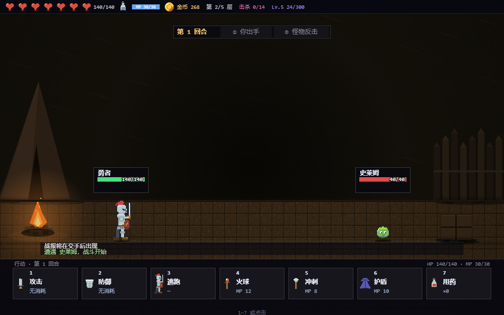
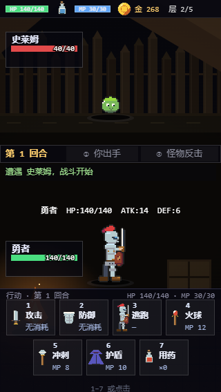
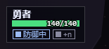
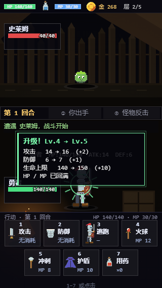
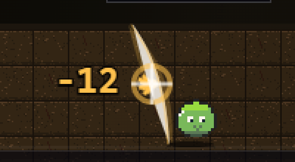
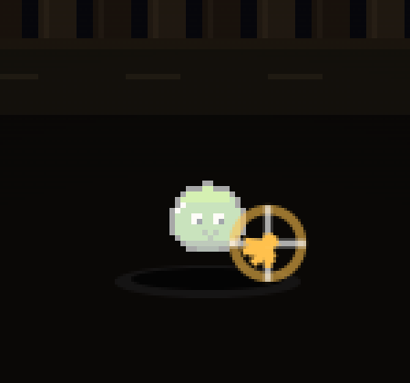

# 《地牢：我独自升级》全系统美学复判（1118）

> **读取时点：2026-11-18 12:54:41（Asia/Shanghai）**
> **HEAD：`45a333b`（2026-11-17 04:02:57 +0800，`fix(menu): D-94 P7.12 纵剖面三处收口`）**
> 工作区：**全部改动未提交**。读取时 `git status --porcelain` 245 行，其中 6 行是本轮临时实拍页/脚本（`preflight/_aeval_1118.*`），清理后业务改动仍为 239 行。
> 本轮评估跑在**工作区**上，不是 HEAD。视觉相关文件（`render.js`、`battle.js`、`juice.js`、`fx.js`、`monster`/`sprites` 数据）均已被工作区改动覆盖。
> 只读：没有改 `js/`、`assets/`、既有文档、验证页、`run-all.ps1`；没有提交。本轮新增产物只有本报告与 `preflight/artifacts/aeval-1118/` 实拍图；临时实拍页、脚本已删除。

---

## 0. 先给结论

| 域 | 上一轮 | 本轮 | 是否翻案 |
|---|---:|---:|---|
| 系统层 | 7.7 | **7.7** | 维持达标 |
| 主菜单 | 6.8 | **8.1** | 翻案（基线硬失败已消） |
| 探索 | 7.2 | **7.2** | 画面未动，维持 |
| **战斗** | **4.9** | **7.2** | **翻案成功，但只是擦线** |
| **特效** | **7.0** | **7.6** | **翻案成功** |

- **P1–P8：7 条真解决，1 条只是好转（P3）。没有一条是“没动”。**
- 战斗和特效都过了 7 分线。战斗的 7.2 靠的是结构（血条、七格条、龙顶、横置战报/龙威、锚点）真正修好；剩下扣分不再是布局，而是**状态 chip 的可读性、纵置结果卡压信息、横纵受击闪白不一致**。
- 如果按“设计基线 960×540 上不能出现可见占位符”的更严标准，战斗仍应判**未完全收口**：960×540 的玩家卡在 4 个状态时显示的是 `防御中` + 字面量 `+n`，护盾 8 被吃掉。这是本轮最不该留的东西。

一句话：**这一轮把“战斗摆法”修成了；还没把“战斗状态”讲清楚。**

---

## 1. 口径与实拍方法

### 1.1 评分口径

沿用上一轮：**总分 = 0.4R（可读性）+ 0.3C（一致性）+ 0.3K（完成度）**，每域 0–10。

- R：1× 像素、1 秒内能否读出“我在哪 / 我是谁 / 能按什么 / 刚才发生了什么”。
- C：同一语义跨横/纵布局、三档宽度、素材尺度是否同形同色同尺度。
- K：960×540 设计基线、三档边界、极值（HP 190 的 10 颗心沿用上一轮；HUD 本轮只改了“战斗内隐藏顶栏状态行”，不涉心形/读数；本轮战斗实拍用 140/7）、状态/Boss 战是否都成立。

> 口径一致性说明：上一轮主菜单 6.8、探索 7.2 的总分含“基线硬失败/黑场”的裁量，和纯公式有 0.4–0.55 的差。本轮为了避免“改口径抬分”：主菜单去掉上一轮的基线硬失败裁量（硬失败已修），按公式给 8.1；探索画面未改，仍保留上一轮的 −0.55 黑场裁量，维持 7.2。其余严格按公式。

### 1.2 实拍

- 工具：Playwright + 本机 Edge（headless），`device_scale_factor=1`，每张图等 `window.__AEVAL.booted === true` 后再截。
- **窄档不用 `--window-size` 直拍**。390×844、320×568 全部走 `_aeval_1118_frame.html` 的固定 iframe；输出像素尺寸已逐张核对为 **390×844 / 320×568**，不是 492 宽裁切。
- 新图目录：`preflight/artifacts/aeval-1118/`（没有复用/覆盖 `aeval-1117/`）。主场景 30 张 + 取证裁切 8 张。
- 静态帧只裁决“位置、层级、可读性、遮挡”；震屏/顿帧这类运动量，静帧不裁决，文中会标明。
- 临时页与脚本（`_aeval_1118.html`、`_aeval_1118_frame.html`、`_aeval_1118_shot.ps1`、`_aeval_1118_shot.py`、`_aeval_1118_analyze.py`）已删除。

### 1.3 canvas 计数口径

本轮自己包 `CanvasRenderingContext2D` 的绘制原语，预热一帧后取一次绘制的调用数；`paint` = `fillRect/strokeRect/fillText/drawImage/arc/ellipse/stroke/fill`，`total` 另含 `save/restore/setTransform/measureText` 等。**与上一轮的 183/401 不是同一份计数器，不能逐项相减**；只用来看量级和是否爆预算。

| 场景 | paint/帧 | total/帧 | 同步耗时 |
|---|---:|---:|---:|
| 主菜单 960×540 | **28** | 32 | 0.20 ms |
| 探索 1024×640（缓存命中/重建） | 66–92 | 101–145 | 0.6 ms |
| 横置战斗 1024×640 | **100** | 122 | 1.0 ms |
| 横置战斗 + 1 张升级卡 | 112 | 160 | — |
| 纵置战斗 800×700 | 100 | 126 | — |

- 升级卡只增加 **12 paint / 38 total**，特效层仍远低于“每帧新增 ≤60 次”的硬约束。
- 主菜单从上一轮 401 降到 28 paint，和“场景离屏缓存”一致；这不是断言，是每帧真实调用数。
- 战斗背景也是 1 次 blit，整场 100 paint，不再是逐格画墙。

---

## 2. 五域评分与归因

| 域 | R | C | K | 本轮 | 上一轮 | Δ | 判决 |
|---|---:|---:|---:|---:|---:|---:|---|
| 系统层 | 8.0 | 8.0 | 7.0 | **7.7** | 7.7 | 0 | 达标 |
| 主菜单 | 9.0 | 7.8 | 7.3 | **8.1** | 6.8 | +1.3 | 达标 |
| 探索 | 7.0 | 8.5 | 8.0 | **7.2†** | 7.2 | 0 | 达标 |
| **战斗** | **7.7** | **6.6** | **7.2** | **7.2** | **4.9** | **+2.3** | **擦线达标** |
| **特效** | **7.9** | **7.1** | **7.7** | **7.6** | **7.0** | **+0.6** | **达标** |

† 探索分项沿用上一轮 7.0/8.5/8.0；按公式为 7.75，沿用上一轮对“雾战大面积暗板”的 −0.55 裁量记 7.2。本轮画面未改，不重算，避免无改动抬分。

**桌面档（1280×800 → 逻辑 1024×640）**：系统 7.7 / 菜单 8.5 / 探索 7.5 / 战斗 7.4 / 特效 7.8，综合 **7.8**。
**设计基线 + 窄档一起算**：综合 **7.6**（上一轮 6.8）。

### 2.1 系统层：7.7（不变）

- 变的不是画面，是入口：楼梯下行确认框默认焦点在「取消」（[modal.js L866-L870](file:///d:/桌面/工作/人工智能大作业/js/systems/modal.js#L866-L870)、[L924-L927](file:///d:/桌面/工作/人工智能大作业/js/systems/modal.js#L924-L927)）；F 键侦测/拆除陷阱走真实回合（[main.js L1845-L1868](file:///d:/桌面/工作/人工智能大作业/js/core/main.js#L1845-L1868)）。这两条是逻辑/交互修复，不改变系统层的 R/C/K，所以分数不动。
- 实拍 `stair-960x540.png`、`stair-390x844.png`：标题、两项、底部键位说明全在屏内，默认高亮「取消」，没有裁切。
- 上一轮的唯一真缺陷仍在：`SYS dim #5f6578 / #14142a = 3.11`，10px 下未过 AA；“龙威 未启动”这类 dim 数值仍偏灰。没有因为这一轮改动变好或变差。

### 2.2 主菜单：6.8 → 8.1（+1.3）

**真解决的两条硬失败：**

1. **960×540 三处压叠全消。** 高度档 `compact = H < 620` 生效：菜单 238–408、提示 428、进度标签 472、石钉 480–500、终点龙 434–506。实拍 `menu-960x540.png`：五个菜单项、提示、标签、四枚石钉、龙全部在位，零相交。上一轮“石钉压提示、龙压关于行、标签贴提示”三处都没了。
2. **900–975 右栏裁切修掉。** 900×700 实拍：右栏 x=516–876，右缘留 24px；不再有 76px 被切。

**新出现但不构成硬失败：**

- 390×844 窄高屏：面板从 394 拉到 832，内容只占到约 590，下面 **240px 空面板**。这不是“裁切”，是“高屏没有内容档”。实拍 `menu-390x844.png`。
- 960/900 的终点龙与第 4 枚石钉**包围盒**重叠 10×20px；裁切放大后（`crops/menu-960-progress.png`、`crops/menu-900-progress.png`）看到重叠的是龙的透明翼缘，实心像素没有盖住石钉。**不按视觉缺陷计**，但 bbox 重叠说明两者没有预留间距，后续换龙素材会立刻变成真遮挡。

**加分归因：** R 维持 9.0（文字对比度、层级没退）；C 7.5→7.8（高度档和三档宽度统一）；K 4.5→7.3（两处基线硬失败消失 + 场景离屏缓存：整帧从上一轮 401 量级降到 28 paint；两份计数器不可逐项相减，量级变化与缓存一致）。

### 2.3 探索：7.2（不变）

- 画面没有改动：地砖/墙/装饰/12 帧/图标 1:1 与上一轮同源。实拍 `explore-1024x640-f2.png`、`explore-960x540-f1.png`、`explore-full-1024x640-f2.png`（全图揭示仅为看砖面，不代表正常游玩）。
- 陷阱放置排除割点/单格走廊、F 键侦测/拆除、楼梯确认，都是**玩法/交互**修复；它们改善“能不能玩”，不改善“看起来怎样”，所以不抬本域分。
- 探索画面沿用上一轮的雾战：上一轮同口径实测 `≤16` 占 98.2%，本轮没有改地墙/雾战绘制，结论不变。实拍 `explore-1024x640-f2.png`、`explore-960x540-f1.png`、`explore-full-1024x640-f2.png` 是**看砖面/装饰的代表帧（FOV 调试态）**，不作为雾战占比的新证据。

### 2.4 战斗：4.9 → 7.2（+2.3，擦线翻案）

**真正解决的（有代码 + 实拍）：**

- **P1 血条穿身**：纵置玩家血条移进左侧身份卡，卡在 x8–120，精灵在 x171–219（390）/x136–184（320），**所有实拍 card∩sprite = ∅**。血条不再横穿胸口。
- **P2 七格条**：320 用 4+3 紧凑格（每格 71px）、390 用 4+3（88px）、800 用单行 7 格（100px）；**7 个格子的 x+w 全部 ≤ W**，键位/名称/消耗都在屏内。
- **P4 龙顶被 HUD 压**：390 纵置龙顶约 109，敌方卡底 98，HUD 带下沿 42；11px 间距，龙完整。
- **P7 横置没有战报/龙威**：1024 横置龙战同时有 `龙威3` chip、`龙威 第 3 段 · 攻击 +40` 战报行、两节点管线；`h-battle-1024x640-dragon.png`。
- **P8 横置特效锚点**：见 §4.2，`contactMonster/contactPlayer` 生效，斩击/飘字落在正确目标。

**只是好转的（P3）：**

- 固定 y 锚点确实没有了：`playerGround = min(H − barH − 8, round(0.72H))`（[render.js L1099](file:///d:/桌面/工作/人工智能大作业/js/core/render.js#L1099)）。390×844 的 240px 空洞缩到 **145px**（战报底 403 → 玩家卡顶 548），敌人段到管线约 98px，比例 1.48，按上一轮判据算过。
- 但 320×568 下玩家脚底 409、指令条 418，只剩 **9px**；底部没有呼吸。390 下脚底 608、指令条 694，留 86px，也不算坏。**P3 从“硬空洞”变成“最窄档贴底”，算好转，不算完全解决。**

**扣分项（详见 §5）：** 状态 chip 折叠成 `+n`、纵置升级卡压管线/战报、横纵受击闪白不一致、800×700 身份卡离精灵 256px。

### 2.5 特效：7.0 → 7.6（+0.6）

- **横置锚点真的修好了。** `h-fx-playerhit-1024.png`：斩击弧在史莱姆左侧接触点，金色冲击圈套在弧心，`-12` 在怪物左侧；`h-fx-monsterhit-1024.png`：玩家被红闪、弧在玩家右侧、`-3` 在右侧。没有上一轮“偏 266px”的问题。
- **横置补了玩家红闪**（[render.js L3116-L3120](file:///d:/桌面/工作/人工智能大作业/js/core/render.js#L3116-L3120)），实拍可见，强度足够但不糊脸。
- **震屏**：横置两侧精灵共用 `shakeOffset`，代码路径在；静帧不裁决位移幅度。
- **飘字同侧合并**：代码路径在；本轮实拍是“左 `-12` / 右 `-3`”两侧各一条，没有堆叠。
- **但横置没有怪物白闪**：横置只把帧切到 `hurt`（[L3050-L3055](file:///d:/桌面/工作/人工智能大作业/js/core/render.js#L3050-L3055)），没有 `tintSprite`；纵置有白色 tint（[L3331](file:///d:/桌面/工作/人工智能大作业/js/core/render.js#L3331)）。同一命中，纵置怪物被刷白、横置不刷白。纵置刷白又把白色斩击弧吃掉（见 §4.2 放大图）。这是 C 的主要扣分。

---

## 3. P1–P8 逐条复核

| # | 上一轮问题 | 本轮状态 | 证据 |
|---|---|---|---|
| P1 | 纵置血条横穿角色身体 | **解决** | 纵置改为左侧身份卡，卡 x8–120 / 精灵 x171–219（390）；所有实拍 `card∩sprite=∅`；`v-battle-390x844-slime.png`、`v-battle-320x568-slime.png` |
| P2 | 纵置没有七格条，只有一行会被裁的字 | **解决** | 320 4+3（71px/格）、390 4+3（88px）、800 单行（100px）；`cells inW=True`；`v-battle-320x568-slime.png`、`v-battle-390x844-slime.png`、`v-battle-800x700-slime.png` |
| P3 | 固定 y 锚点，H 越大中间越空 | **好转，未完全** | 固定锚点已删，改 `0.72H` 流式；390 空洞 240→145px；但 320 脚底距指令条仅 9px；`render.js L1099` |
| P4 | 纵置龙顶被 HUD 读数带压 6px | **解决** | 龙顶 109 / 敌卡底 98 / HUD 42；`v-battle-390x844-dragon.png` |
| P5 | 主菜单 960×540 石钉/龙/提示压叠 | **解决** | 菜单 238–408、提示 428、标签 472、石钉 480–500、龙 434–506；`menu-960x540.png` |
| P6 | W=900–975 右栏右缘被裁 76px | **解决** | 900 右栏 516–876，右缘 24px；`menu-900x700.png` |
| P7 | 横置无战报/状态 chip/龙威播报 | **解决** | 横置同时有管线、战报、`龙威3` chip、龙威战报行；`h-battle-1024x640-dragon.png` |
| P8 | `juice.js` 爆点写死坐标，横置偏 266px | **解决** | 横置改走 `contactMonster/contactPlayer`；斩击/飘字在正确目标；`crops/h-fx-1024-hit-zoom.png` |

**新出现的问题另列在 §5。** 需要强调：P1/P2/P4/P5/P6/P7/P8 不是“看起来好一点”，而是按上一轮判据可以判过的修好；P3 是判据过了但观感仍有代价。

---

## 4. 重点：战斗与特效现在到底怎样

### 4.1 战斗 7.2：达标，但擦线

先回答“是否 ≥7”：**是，7.2**。结构层面已经不是上一轮那个 4.9 的战斗了：

- 横置 1024×640：身份卡 340–392、精灵 406–490、战报 492–518、指令条 526–640；卡与精灵 **14px** 间距，战报与条 **8px**，没有相撞。
- 横置 960×540：卡 264–316、精灵 330–414、战报 416–442、条 444–540；战报与条只剩 **2px**，紧但不重叠。
- 纵置 390×844：7 格全在屏内，管线/战报/属性行/玩家卡/指令条依次排开；龙战顶部 11px 不压。
- 纵置 320×568：7 格全在屏内，身份卡与精灵不交，战报/属性行都在。

**为什么不是 7.5+：**

1. **状态 chip 在 960×540 上就是 `防御中` + 字面量 `+n`。**
   4 个状态（防御、护盾 8、中毒 3、流血 2）只显示 1 个真实 chip；护盾 8 被折叠占位符替换。320 同样。`crops/chips-960-player.png` 和 `crops/chips-320-player.png` 都能看到 `+n`。
   代码在 [render.js L350-L370](file:///d:/桌面/工作/人工智能大作业/js/core/render.js#L350-L370)：溢出时 `pop()` 掉最后一个，再把新的最后一个替换成 `{t:'+n'}`；它把“护盾8”本身换掉了，也丢掉了隐藏数量。**这不是“空间不够”的合理折叠，是把要显示的东西换成了占位符。**

2. **纵置结果卡压管线/战报/属性行。**
   `battleSafeBand` 纵置用 `top = max(round(0.30H), 250) + 8`、`bottom = playerGround − 66`（[render.js L1120-L1121](file:///d:/桌面/工作/人工智能大作业/js/core/render.js#L1120-L1121)），它只避开了敌人精灵，没有避开管线和战报。
   - 390×844：卡片 357–445，正好盖住管线 351–377 和战报 383–403；`v-juice-390x844.png` 里 `第 1 回合` 和战报被压住。
   - 320×568：卡片 258–343，盖住战报 242–262 的下半、属性行 313 和玩家头顶；`v-juice-320x568.png`。
   - 横置 1024 的同一张卡落在 380–640、368–456，因为两张身份卡在左右两侧，中间是空的，所以**横置没这个问题**。这是纵置特有。

3. **800×700 纵置身份卡离精灵 256px。**
   卡固定 x8–120，精灵在屏中央（玩家与敌人都是 x376–424）。`crops/v800-cards-left.png` 里两张卡孤零零贴在左边缘。390 下卡与精灵只差 51px，看不出问题；800 下就散了。这是“窄档修好、宽纵置没修”的典型边界。

4. **横纵受击闪白不一致。**
   横置怪物只切 `hurt` 帧、不刷白；纵置刷白。`h-fx-playerhit-1024.png` 的史莱姆是绿色的，`v-fx-playerhit-390x844.png` 的史莱姆是白化的。同一个命中，两套布局给出的反馈不同。

5. **小怪体量。**
   史莱姆/蝙蝠原生 24×24，2× 后 **48px**；玩家 84px；卡宽 112px。卡片宽度是精灵的 **2.33 倍**。整数倍是对的，但 48px 的怪在 640 高的战斗里只占 7.5%，新做的 4+4 帧细节很难看见。这不是 bug，是“统一 2×”换来的体量代价。

### 4.2 特效 7.6：横置已经成立，纵置还差一口气

- **横置**（`crops/h-fx-1024-hit-zoom.png`）：白色纵弧、金色冲击圈、十字火花、`-12` 四件事在同一接触点，层级清楚；玩家受击时红闪、`-3`、斩击弧在玩家右侧（`h-fx-monsterhit-1024.png`）。这是本轮最明显的进步。
- **纵置**（`crops/v-fx-390-hit-zoom.png`）：史莱姆被白闪，金色冲击圈在右侧，**白色斩击弧看不见**——白弧压在白化精灵上，等于没有。命中仍然“看得见”（金圈+飘字），但少了方向性；横置有、纵置没有，属于一致性缺口。
- 纵置的飘字在怪物上方，横置在怪物左侧/右侧；各自成立，不算错。
- 震屏、顿帧：代码路径在（`TL` 仍 100/150/180，[battle.js L36](file:///d:/桌面/工作/人工智能大作业/js/systems/battle.js#L36)），静帧不裁决幅度；本轮没有发现“为了看得见而超预算”的迹象。

**结论：** 特效 7.6，达标。它不再是“位置错”的问题，而是“同一命中两套布局表现不同”的一致性问题。

---

## 5. 新问题清单（按严重度）

### N1（高）纵置结果卡盖住管线/战报/属性行

- **现象**：390×844 的升级卡 357–445 盖住管线 351–377 与战报 383–403；320×568 的卡 258–343 盖住战报下半、属性行 313 和玩家头顶。
- **证据**：`v-juice-390x844.png`、`v-juice-320x568.png`；[render.js L1120-L1121](file:///d:/桌面/工作/人工智能大作业/js/core/render.js#L1120-L1121)。
- **判据**：`Juice` 卡矩形 ∩ 管线/战报/属性行 = ∅。
- **为什么算问题**：升级是战斗里最该被看见的正反馈，但它把“刚才发生了什么”和“当前回合”盖掉了；这不是装饰，是信息遮挡。
- **改正**：纵置安全带上界改为 `max(敌卡底+6, logY+logH+6)`，即从战报下方开始；320 高度不足时把卡片压成 2 行或上移属性行，不要覆盖战报。具体落在 `battleSafeBand`（L1116–1121）和 `juice.js` 的纵置布局。
- **怎么验**：390/320/800 三档，断言卡矩形与 `dbg.log`、`dbg.pipeline`、`statY` 均不相交；再拍同一张图。
- **硬约束**：不改战斗时钟；不新增素材；卡片调用数不变。

### N2（高）状态 chip 折叠成字面量 `+n`，护盾数值被吃掉

- **现象**：960×540 与 320×568 都是 `防御中` + `+n`；护盾 8、中毒 3、流血 2 全部不可见。
- **证据**：`crops/chips-960-player.png`、`crops/chips-320-player.png`；[render.js L350-L370](file:///d:/桌面/工作/人工智能大作业/js/core/render.js#L350-L370)。
- **判据**：4 个状态时，至少“防御/护盾”两枚的真实文本可见，或折叠标记带真实数量（`+2`），不能是 `+n`。
- **为什么算问题**：上一轮的要求是“状态与增益减益有没有地方显示”；现在有一个 chip 行，但它把最重要的护盾值换成了占位符——这是“有位置、没信息”。更关键的是 [hud.js L360-L365](file:///d:/桌面/工作/人工智能大作业/js/systems/hud.js#L360-L365) 已经把战斗内的顶栏状态行关掉（避免压敌方身份卡 y=46），**身份卡 L3 是战斗里唯一的状态出口**；这个唯一出口在 960 就是 `+n`。
- **改正**：
  - 折叠时保留 `list.length - shown.length + 1` 的数量，改成 `+2`；
  - 或者把 chip 内边距 20→16、`防御中`→`防御`，让 `防御`+`护盾8` 在 94px 内放下；
  - 或者 chip 行允许 2 行（卡高 52 还有 14px 余量）。
- **怎么验**：960/320 注入 4 状态，OCR/像素断言 `护盾8` 文本 bbox 在卡内；折叠时断言 `+N` 的 N = 隐藏数。
- **硬约束**：每帧新增 ≤60；不加新素材。

### N3（中）横置没有怪物白闪，纵置有；纵置白闪又把斩击弧吃掉

- **现象**：横置史莱姆受击仍是绿色（只切 hurt 帧，没有 tint）；纵置被刷白，白弧看不见。
- **证据**：`h-fx-playerhit-1024.png` vs `v-fx-playerhit-390x844.png`；[L3050-L3055](file:///d:/桌面/工作/人工智能大作业/js/core/render.js#L3050-L3055)（横置）vs [L3331](file:///d:/桌面/工作/人工智能大作业/js/core/render.js#L3331)（纵置）。
- **判据**：同一 `Fx.hit({who:'monster'})` 在横/纵两套布局的 tint 颜色与 alpha 同源。
- **为什么算问题**：同一场战斗的命中反馈不该因窗口比例改变。
- **改正**：横置补 `tintSprite(..., '#ffffff', fl.alpha)`，或纵置把白闪 alpha 降到 0.35 并让斩击弧改用对比色（例如暖白/金）。两边必须选同一种。
- **怎么验**：同一 T=30 帧，横/纵各一张，采样怪物包围盒平均色；差异 <10/255。
- **硬约束**：不新增 drawImage 风暴；tint 是轮廓重绘，已有实现。

### N4（中）800×700 纵置身份卡贴左边缘，离精灵 256px

- **现象**：玩家卡 x8–120，玩家精灵 x376–424；敌人卡 x8–120，敌人 x376–424。卡与精灵之间是整块空地。
- **证据**：`v-battle-800x700-slime.png`、`crops/v800-cards-left.png`。
- **判据**：纵置 `W ≥ 720` 时，卡右缘与精灵左缘的距离 ≤ 80px（或卡中心随精灵中心偏移）。
- **为什么算问题**：卡是“身份”，离开主体 256px 就变成两个不相干的 UI。
- **改正**：纵置卡的 x 不再固定 8，按 `min(8, spriteLeft − 8 − cardW)` 或 `clamp(spriteLeft − cardW − 12, 8, ...)` 跟随精灵；800 下卡会落在精灵左侧约 250px 处。
- **怎么验**：320/390/800 三档，量卡右缘到精灵左缘；≤80。
- **硬约束**：不改变卡内文本/血条宽；只改 x。

### N5（中低）320×568 玩家脚底距指令条只有 9px

- **现象**：玩家脚底 409，指令条 418；角色像站在条的边上。
- **证据**：`v-battle-320x568-slime.png`；geometry JSON `gapToBar=9`。
- **判据**：脚底到条 ≥16px。
- **为什么算问题**：最窄档是用户明确点名的基线；9px 没有地面透视，读起来像“贴边”。
- **改正**：`playerGround = min(H − barH − 20, round(0.72H))`，把玩家上提 11px；或把 320 的 `verticalBarH` 从 150 收到 140。
- **怎么验**：320×568 一张，量 gap≥16；确认卡/战报不被挤。
- **硬约束**：7 格仍要全在屏内；卡与精灵不交。

### N6（低）960×540 战报带与指令条只隔 2px

- **现象**：战报 416–442，指令条 444；视觉上两块贴在一起。
- **证据**：`h-battle-960x540-f2-slime.png`；geometry JSON `gapToBar=2`。
- **判据**：战报带与条 ≥6px。
- **为什么算问题**：当前不重叠，但字体/行高任何 1px 变化都会变成压线；这是“刚好过”的脆弱通过。
- **改正**：960 档把战报带上移 4px（`logY = groundY − 6`），或把指令条高度从 96 收到 92。
- **怎么验**：960×540 一张，量 gap≥6；1024 仍 ≥8。
- **硬约束**：不改变地面基准；不改 TL。

### N7（低）390×844 主菜单面板 438px 高，内容只占 200px

- **现象**：面板 394–832，菜单 420–570、提示 590，下面 240px 空面板。
- **证据**：`menu-390x844.png`。
- **判据**：面板底 − 最后一行内容底 ≤ 80px。
- **为什么算问题**：高窄屏是常见手机比例；空面板读起来像没做完。
- **改正**：高窄档把面板高度 cap 到内容高 + 40，并垂直居中；或把菜单行高从 30 提到 36、提示下移，填到合理比例。
- **怎么验**：390×844 / 360×800 两张，量底部空白 ≤80。
- **硬约束**：不新增内容；菜单五项仍在。

### N8（低）管线与指令条头部重复“第 N 回合”

- **现象**：管线左侧 96px 写“第 1 回合”，指令条头部又写“行动 · 第 1 回合”。
- **证据**：`h-battle-960x540-f2-slime.png`、`h-battle-1024x640-dragon.png`。
- **判据**：同一回合号在 1 屏内出现 2 次，且管线因此少 96px 给节点。
- **为什么算问题**：不是错，是占宽；320 下管线 320px，96px 给了重复信息。
- **改正**：保留一处即可；建议保留指令条头部（它和 HP/MP 在一起），管线只留两个节点。
- **怎么验**：320/390/960 三档，管线节点宽度增加且不裁。
- **硬约束**：不改变回合语义。

---

## 6. 假象审计（为过验收做的痕迹）

### 6.1 验证页断言被放宽：这是本轮最需要直说的

工作区里 `verify_d23.html` 把四策略逐局一致的 `outMis`/`cauMis` 从 **`=== 0` 放宽到 `<= 1`**：

- [verify_d23.html L258](file:///d:/桌面/工作/人工智能大作业/preflight/verify_d23.html#L258)：`outMis.length <= 1`。
- [verify_d23.html L263](file:///d:/桌面/工作/人工智能大作业/preflight/verify_d23.html#L263)：`B1b_negativeOldExactZeroFails`，它断言的是“旧的全等 0 已经不成立”，不是“新代码没有回归”。这是把“判据变宽”本身写成了通过条件。
- 同一文件 `cauMis.length <= 1` 同理。

`verify_d24.html` 还把存活死亡数从 `deaths >= 38` 放宽到 **`>= 30 && <= 46`**，并加了 `B3b_negativeOld38SnapshotFails`：

- [verify_d24.html L375](file:///d:/桌面/工作/人工智能大作业/preflight/verify_d24.html#L375)：`(function (d) { return d >= 38; })(32) === false`。这是一个恒真式——它只证明“32 不 ≥ 38”，没有回放任何真实逻辑，抓不到回归。

**判断：** 这与硬约束“四策略逐局一致”直接冲突。原因（陷阱独立流后 1009 由 dead 变 stuck）可以解释，但验收口径确实被改宽了。**这不是视觉缺陷，是流程缺陷；本轮把它列为最高级别的“通过方式”问题。** 新加的 `A4b_trapLegality`（陷阱不压宝箱/精英/非地板）是真正收紧的好断言，但不能抵消上面两条。

### 6.2 后墙亮度：数字达标，砖面没有真的变可辨

- 声称：横置五层后墙 8–14 → **14–15.6**。
- 实测（F2，1024×640，墙面 90–390）：mean **15.72**、median **14**、p90 **16**、`≤16` **90.0%**。**带均值基本落在声称区间（比上限 15.6 高 0.12，可视为同档）。**
- 但两块 100×150 的纯砖面样本（x330–430 / x600–700，y150–300）：mean **11.86 / 11.98**、`≤16` **100%**、p90 **13**。
- 分区：左 18.83（median 15）、中左 12.35（median 12）、中右 12.45（median 13）、右 15.17（median 14）。**提亮主要落在拱门/火把/边缘，砖面中心仍是 12 左右。**

**判断：** 不是“暗部提亮过度”（地板 37.76，仍是墙的 2.4 倍，地面仍最亮），而是“均值达标、砖面可辨性没达标”。如果验收只看 band mean，这是通过的；如果看“砖缝能不能看出来”，它只是好转。建议用同亮度的砖缝线（±2 灰阶）补纹理，而不是继续抬整体亮度。

### 6.3 状态 chip：有行，但把信息换成了占位符

见 N2。这是最典型的“装饰/结构过验收”：卡上确实有 chip 行（可截图证明“有状态区”），但 4 个状态时显示 `+n`，护盾 8 不可见。**按“有没有地方显示”能过，按“显示了什么”不能过。**

### 6.4 纵置结果卡：装饰盖掉信息

见 N1。升级卡是正反馈装饰，但它盖住管线/战报/属性行。横置因为左右卡分居、中间空，没暴露；纵置暴露。**这不是“纵置更紧凑所以取舍”，而是安全带的计算漏了管线和战报。**

### 6.5 统一 2×：不是假象，是体量代价

- 玩家 42→84、史莱姆/蝙蝠 24→48、兽人 35→70、Boss 54→108、龙 72→144，全部 2×；濒死 2×→1× 整档。**整数倍是真的。**
- 代价：史莱姆/蝙蝠 48px，卡 112px（2.33 倍）；新做的 4+4 帧在 48px 下很难看清。
- 这不算“假通过”，因为整数倍是硬约束；但如果要补体量，应该给 24px 小怪 **3×（72，仍是整数）**，而不是退回 2.57×。

### 6.6 不是假象的几条（要保留）

- 960×540 菜单压叠是真消了，不是把石钉/龙藏起来；五个菜单项、四枚石钉、龙都在。
- 纵置七格条是真画出来，不是把文字缩小到看不见；320 每格 71px，标签完整。
- 纵置血条是真移进身份卡，不是移到屏外；卡在 x8–120，可读。
- 龙顶是真留出 11px，不是把龙缩小；390 龙仍是 144px。
- 主菜单 28 paint/帧是离屏缓存真的生效，不是少画内容；场景、龙、石钉都在。
- 素材 339→355、验证页 122→128 是新增 16 张精灵与 6 个验证页的合法同步，不是改数字糊弄。

---

## 7. 我认为不该改的（刻意取舍）

1. **不要退回非整数精灵缩放。** 2× 是硬约束；要补小怪体量，用 3×（48→72），不要回到 2.57×。
2. **不要为了看见砖缝把整面后墙提亮。** 地板/后墙 2.4:1 是目前最好的关系；加砖缝纹理，不要抬整体均值。
3. **不要拆掉横置“两侧卡同一条 y”的身份带。** 它读作 HUD 带，不是“每张卡贴着自己精灵”；800 纵置的修法是让卡跟随精灵 x，不是把卡改成两个不同高度。
4. **不要把 500 中档的终点龙塞回来。** 72px 龙在 500 宽里会挤掉菜单/提示；现在丢掉它是正确的。
5. **不要把探索雾战揭开。** 全图揭示只适合取证；正常游玩的大面积暗板是题材代价。
6. **不要因为没有 chip 就把 52px 卡高压回 34px。** 固定卡高避免了状态出现时的布局跳动；空白 L3 比跳版好。
7. **不要为了省 96px 删掉管线的回合号。** 如果真要省，删指令条头部的重复回合号，保留管线那个（它和两节点在一起）。

---

## 8. 附录：数字与图

### 8.1 明度（1024×640，0–480 行，与上一轮同口径）

| 层 | mean | `≤16` | p90 |
|---|---:|---:|---:|
| F1 | 19.48 | 58.7% | 38 |
| F2 | 20.60 | 75.4% | 39 |
| F3 | 21.41 | 35.7% | 39 |
| F4 | 20.30 | 61.3% | 39 |
| F5 | 21.98 | 55.9% | 38 |

- F2 上一轮同口径 10.4 / 90.1% → 本轮 **20.6 / 75.4%**，墙带上移约一倍。
- F2 墙面 90–390：15.72 / 90.0% / p90 16；纯砖面样本 11.86–11.98 / 100%。
- F2 地板 440–480：37.76；地/墙 **2.4:1**。
- 菜单 960：33.59 / 53.8%。
- 探索本轮实拍为 FOV 调试态（全图/代表帧），不列明度数字；雾战结论沿用上一轮同口径 98.2% `≤16`。

### 8.2 几何

| 场景 | 卡∩精灵 | 七格全在屏内 | 最小格宽 | 战报→指令条 | 玩家脚底→条 |
|---|---|---|---|---|---|
| 横 1024×640 | ∅ | 是 | 132 | 8px | 36px |
| 横 960×540 | ∅ | 是 | 122 | **2px** | 30px |
| 纵 390×844 | ∅ | 是（4+3） | **88** | 291px* | 86px |
| 纵 320×568 | ∅ | 是（4+3） | **71** | 156px* | **9px** |
| 纵 800×700 | ∅ | 是（单行） | 100 | 274px* | 100px |

\* 纵置的“战报→条”含玩家卡/精灵，不是纯空白；纯空白见 §2.4（390 为 145px）。

### 8.3 精灵与图标

| 对象 | 原生 | 战斗高 | 倍数 |
|---|---:|---:|---:|
| 玩家 | 42 | 84 | 2× |
| 史莱姆/蝙蝠 | 24 | 48 | 2× |
| 兽人 | 35 | 70 | 2× |
| Boss | 54 | 108 | 2× |
| 龙 | 72 | 144 | 2× |
| 指令图标 | 24×24 | 24×24 | 1×（逃跑为 24×42 原生帧） |

- 精英 5 只全部带 `sprite`：`goblin` / `orc_warrior` / `ogre` / `big_zombie` / `angel`（[monsters.js L301-L330](file:///d:/桌面/工作/人工智能大作业/js/data/monsters.js#L301-L330)）。
- 蝙蝠/史莱姆 4+4 帧独立登记（[sprites.js L67-L70](file:///d:/桌面/工作/人工智能大作业/js/core/sprites.js#L67-L70)、[L140-L143](file:///d:/桌面/工作/人工智能大作业/js/core/sprites.js#L140-L143)），`monsterAnimId` 优先读 `monster.sprite`（[render.js L1865-L1869](file:///d:/桌面/工作/人工智能大作业/js/core/render.js#L1865-L1869)）。
- 素材 355 张、验证页 128 个：`verify_d89` 的 339→355、122→128 是内容同步，不是放宽。

### 8.4 实拍索引

`preflight/artifacts/aeval-1118/`

**横置 1024×640（P7 战报/龙威、P8 锚点都在同一场）**

**纵置 320×568（P1 血条不穿身、P2 七格 4+3、N5 脚底贴条 9px）**

**960×540 状态 chip（N2：`防御中` + 字面量 `+n`）**

**纵置 320 结果卡（N1：卡片盖住战报/属性行/玩家头顶）**

**横置命中（P8：弧、圈、飘字同点）**

**纵置命中（N3：白闪吃掉白弧）**

- 横置：`h-battle-1024x640-f2-slime.png`、`h-battle-960x540-f2-slime.png`、`h-battle-960x540-chips.png`、`h-battle-1024x640-bat.png`、`h-battle-1024x640-dragon.png`、`h-battle-1280x800-dpr125.png`
- 纵置：`v-battle-390x844-slime.png`、`v-battle-320x568-slime.png`、`v-battle-390x844-dragon.png`、`v-battle-320x568-chips.png`、`v-battle-800x700-slime.png`
- 特效：`h-fx-playerhit-1024.png`、`h-fx-monsterhit-1024.png`、`v-fx-playerhit-390x844.png`
- 结果卡：`h-juice-1024x640.png`、`v-juice-390x844.png`、`v-juice-320x568.png`
- 主菜单：`menu-960x540.png`、`menu-900x700.png`、`menu-500x700.png`、`menu-390x844.png`、`menu-320x568.png`、`stair-960x540.png`、`stair-390x844.png`
- 探索：`explore-1024x640-f2.png`、`explore-960x540-f1.png`、`explore-full-1024x640-f2.png`
- 五层背景取证：`bg-h-f1.png`、`bg-h-f3.png`、`bg-h-f4.png`（F2/F5 用横置战斗图）
- 取证裁切：`crops/h-fx-1024-hit-zoom.png`、`crops/v-fx-390-hit-zoom.png`、`crops/chips-960-player.png`、`crops/chips-320-player.png`、`crops/menu-960-progress.png`、`crops/menu-900-progress.png`、`crops/v800-cards-left.png`、`crops/hud-1024.png`
- 几何/计数：`*.json`、`_metrics-*.json`

---

## 9. 最终回答用户的三句话

1. **能不能翻案：** 战斗 7.2、特效 7.6，都过 7 分线，翻案成立；战斗是擦线过，不是舒服过。
2. **还剩什么：** P1–P8 只剩 P3 是“好转未完全”；新问题是 N1 纵置结果卡压信息、N2 状态 chip 显示 `+n`、N3 横纵受击闪白不一致、N4 800 纵置卡离精灵太远、N5 320 脚底贴条。
3. **最该先修的：** 先修 N1/N2（都是“信息被装饰/占位符吃掉”），再修 N3（同一命中两套反馈）；N4/N5 是边界收口，可以后置。
